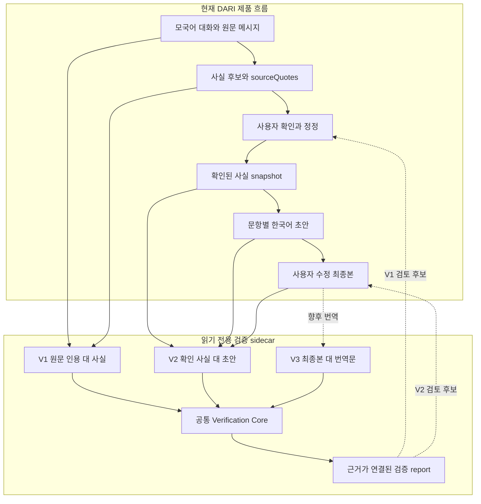
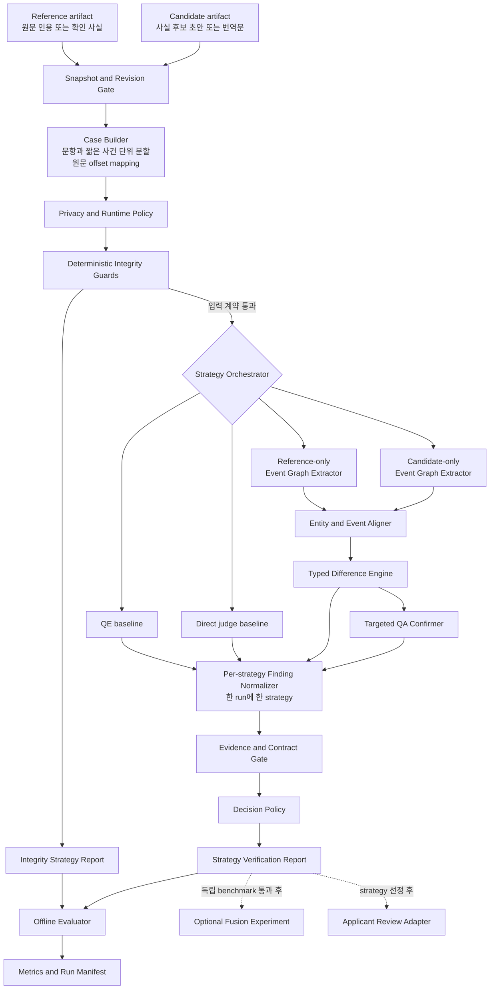
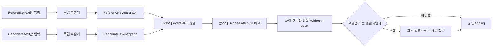
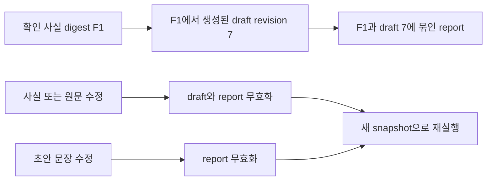

# DARI 검증 시스템 아키텍처 v0.2

- 작성일: 2026-10-12
- 상태: 실험 설계안
- 대상 브랜치: `experiment/verification-architecture`
- 제품 연동 상태: 미연동. 현재 단계는 검증 방법과 계약을 비교하는 연구용 설계다.

텍스트를 어떤 정보로 구조화하고 graph끼리 어떻게 비교할지에 대한 핵심 방법론은 [GRAPH_METHOD.md](GRAPH_METHOD.md)에 별도로 정의한다. 이 문서는 그 방법을 실행·평가하고 이후 제품과 연결하기 위한 주변 경계를 다룬다.

## 1. 설계 결론

DARI 검증 시스템은 **현재 제품을 수정하지 않는 읽기 전용 sidecar**로 둔다. 사용자가 확인한 원문·사실·초안의 특정 revision을 불변 snapshot으로 만든 뒤, 다음 세 층에서 검증한다.

1. **결정론적 무결성 검사**: 인용문, fact ID, 누락, 정정 전 값, revision을 코드로 검사한다.
2. **다중 의미 검출기**: 일반 QE와 direct judge를 기준선으로 두고, DARI 전용 사건 그래프를 핵심 가설로 실험한다.
3. **국소 재확인과 사용자 검토**: 위험한 차이만 QA로 다시 확인하고 양쪽 근거를 사용자에게 보여준다.

연구 단계에서는 검출기 결과를 처음부터 합치지 않는다. `qe_baseline`, `direct_judge`, `domain_graph`, `graph_confirmed`를 같은 데이터와 계약으로 **독립 평가**한 뒤, 성능 근거가 생긴 조합만 별도의 fusion 실험으로 검증한다.

이 구조를 택하는 이유는 다음과 같다.

- DARI 사용자는 번역 대상 언어를 직접 검토하기 어렵다. 단일 품질 점수보다 **어디에서 어떤 의미가 달라졌는지 보여주는 근거**가 필요하다.
- 현재 제품에는 모국어 대화, 정확한 원문 인용, 확실성, 정보 출처, 사건 ID, 정정 관계, 문장별 fact ID가 이미 있다. 이 구조를 버리고 문서 전체를 다시 LLM에 맡기면 검증 가능성이 낮아진다.
- 일반 QE는 부정·숫자·개체·누락 탐지의 강한 기준선이지만, 행위자 교체·정보 출처·불확실성·시간 순서·인과관계처럼 표면 문장이 비슷한 관계 오류는 놓칠 수 있다.
- full AMR이나 학습형 graph matcher는 다국어 parser 품질, 학습 데이터, 모바일 비용 면에서 지금 단계에 과하다. 필요한 관계만 담은 작은 domain event graph가 현재 가설을 가장 직접적으로 시험한다.
- 검출기나 parser가 실패했을 때 빈 finding을 반환하면 사용자가 이를 “문제 없음”으로 오해할 수 있다. 실패는 항상 `indeterminate`로 드러나야 한다.

## 2. 현재 DARI에 맞춘 검증 경계

현재 활성 제품 흐름은 과거 프로토타입의 “모국어 원문 → 영어 번역”만이 아니다. `capacitor-web/`은 **모국어 대화 → 사실 후보 → 사용자 확인·정정 → 한국어 초안 → 사용자 수정**을 수행한다. 따라서 다음 세 경계를 구분한다.

| 경계 | 기준 artifact | 검사할 artifact | 지금 필요한가 | 핵심 질문 |
| --- | --- | --- | --- | --- |
| V1 추출 검증 | 사용자 원문 인용 | 구조화된 사실 후보 | 예 | 원문이 사실 카드로 정확히 추출됐는가? |
| V2 초안 검증 | 확인된 사실과 연결된 원문 근거 | 생성·수정된 한국어 초안 | 예 | 사실·관계·불확실성이 초안에 보존됐는가? |
| V3 번역 검증 | 사용자가 확정한 최종 초안 | 향후 한국어·영어 번역문 | 후속 | 번역에서 같은 의미가 보존됐는가? |

V1을 통과하지 않은 fact를 V2의 확정적인 정답으로 간주하지 않는다. 사용자가 확인한 fact는 현재 제품이 채택한 reference artifact지만, 법률적 진실이나 외부 세계의 사실을 의미하지는 않는다. offline 평가의 gold annotation은 실행 시 검출기에 전달하지 않고 evaluator만 사용한다.

### 2.1 제품 흐름과 검증 sidecar

검증 sidecar는 `IntakeSession`, fact, 초안을 직접 바꾸지 않는다. report가 가리키는 근거를 본 사용자가 fact나 초안을 수정하면 제품의 정상 편집 흐름이 새 revision을 만들고, 이전 report는 stale 상태가 된다.

## 3. 전체 아키텍처

도식의 여러 strategy 화살표는 동시에 결과를 섞는다는 뜻이 아니라 **같은 adapter 자리를 교체할 수 있음**을 뜻한다. 연구 run 하나는 strategy 하나의 report를 만들고, evaluator가 서로 다른 run의 report를 나중에 비교한다. fusion은 독립 benchmark를 마친 뒤 별도 strategy ID로만 실험한다.

### 3.1 Domain event graph 내부 흐름

두 extractor는 서로 반대편 문서를 보지 않는다. 한쪽 표현을 본 채 다른 graph를 만들면, 실제 번역 오류를 같은 구조로 억지 정렬할 수 있기 때문이다.

### 3.2 조사 연구를 설계에 반영한 방식

| 연구 접근 | 채택하는 부분 | 그대로 채택하지 않는 이유 |
| --- | --- | --- |
| COMETKiwi, xCOMET | reference-free QE, 오류 span, severity를 강한 기준선으로 사용 | 관계 변화 전체를 설명하는 최종 판정기로 보기 어려움 |
| MEANT, PropBank SRL | predicate와 participant role을 `Event`, `ACTOR`, `TARGET`로 표현 | 언어별 SRL 품질과 문서 수준 공참조가 병목 |
| AMR, Smatch | entity/event와 방향성 관계를 graph로 표현하는 발상 | full AMR은 다국어·모바일 MVP에 무겁고 문자열 hard match가 paraphrase에 약함 |
| S²MATCH, FGW | entity/event 정렬의 soft candidate score | 반의어·부정까지 embedding 유사도에 맡길 수 없음 |
| BERTScore, MoverScore, AlignScore | 저비용 비교군과 triage 신호 | 역할 반전에도 높은 유사도가 나올 수 있고 설명력이 제한됨 |
| QuestEval | graph가 찾은 의심 edge만 국소 질문으로 재확인 | 전체 문서 QA는 비용과 질문·답변 오류가 큼 |
| FactBank, TimeBank, PDTB | 확실성의 적용 범위, 사건 간 시간·인과 edge 설계 | 전체 annotation 체계를 그대로 구현하면 초기 범위가 커짐 |
| Graph Matching Network | 장기 연구 후보 | 정답 graph pair가 충분하지 않음 |

따라서 중심 가설은 **작은 DARI domain event graph**, 비교 기준은 **일반 QE와 direct judge**, false positive를 줄이기 위한 후단은 **targeted QA**로 정한다.

## 4. 모듈 설계

### M0. Snapshot and Revision Gate

**책임**

- stage에 맞는 최신 immutable artifact를 읽는다. V1은 사용자 원문과 아직 확인 전인 fact 후보 snapshot을 검사하고, V2·V3는 사용자 확인이 끝난 reference snapshot만 허용한다.
- reference와 candidate가 어떤 입력 revision에서 만들어졌는지 검증한다.
- content digest를 계산해 report가 정확히 어떤 텍스트를 검증했는지 고정한다.
- source나 fact가 바뀐 뒤 생성된 오래된 초안, 초안이 바뀐 뒤의 오래된 report를 거부한다.

**최소 입력 메타데이터**

| 필드 | 의미 |
| --- | --- |
| `case_id` | 실행과 무관한 안정적인 case ID |
| `stage` | `extraction`, `drafting`, `translation` |
| `session_id`, `question_id` | 제품 artifact 위치 |
| `reference_revision`, `candidate_revision` | 대응 revision |
| `reference_digest`, `candidate_digest` | 실제 내용 digest |
| `source_language`, `candidate_language` | 언어쌍 |
| `data_classification` | `synthetic`, `deidentified_research`, 향후 승인된 실제 자료 |
| `source_map` | message, fact, sentence와 원문 offset의 대응 |

revision이나 digest가 맞지 않으면 `revision_mismatch`를 가진 `invalid_input`으로 종료한다. stale artifact를 모델에 넘겨 결과를 만든 뒤 경고만 붙이는 방식은 사용하지 않는다.

### M1. Verification Case Builder

**책임**

- 제품 artifact를 공통 `VerificationCase`로 바꾼다.
- 문항별로 나누고, 문항 안에서는 사건 몇 개가 담긴 짧은 문단 window를 만든다.
- 정규화 문자열은 비교용으로만 만들며 원문을 그대로 보존한다.
- Unicode code point 기준 `start`, `end`, `quote`를 원문으로 되돌리는 mapping을 유지한다.
- V1은 `sourceQuote ↔ fact`, V2는 `confirmed facts + quotes ↔ draft section`, V3는 `final draft ↔ translation` 쌍을 만든다.

모바일 모델의 문맥 한도와 단일 실행 제약 때문에 기본 검증 단위는 전체 문서가 아니라 문항·사건 window다. 인물 일관성이나 사건 순서처럼 문항을 넘는 오류는 별도의 document-level pass에서 검사한다.

### M2. Privacy and Runtime Policy

**책임**

- 현재 case의 언어쌍, 필요한 evidence 수준, 사용 가능한 모델과 실행 위치를 capability registry에서 확인한다.
- 연구 단계에서는 합성 또는 비식별 자료만 허용한다.
- 실제 자료를 다루게 될 경우 기기 내 실행을 기본 경로로 두고, 외부 서비스 전송은 별도 정책과 사용자에게 보이는 payload 확인을 거친 adapter에서만 허용한다.
- 원문과 번역문 사이의 같은 인물을 동일한 token으로 가명화해야 할 때 mapping을 기기 안에 유지한다.
- report와 manifest에는 원문 전체를 기본 저장하지 않는다.

날짜, 관계, 기관 역할처럼 의미 검증에 필요한 정보를 기계적으로 모두 삭제하면 검증 자체가 무의미해질 수 있다. 따라서 redaction 범위는 검증 정확도와 함께 별도로 평가한다. 실행 경로가 지원되지 않으면 자동으로 네트워크 fallback하지 않고 `unsupported_capability`로 `indeterminate`를 반환한다.

### M3. Deterministic Integrity Guards

현재 코드가 이미 수행하는 검사와 새로 만들 검사를 구분한다.

**현재 코드에서 재사용할 검사**

- `sourceQuote`가 지정한 원문 메시지에 실제로 존재하는지 검사
- fact와 문항, event ID, source ID 연결 검사
- 초안 문장에 존재하지 않는 fact ID가 붙지 않았는지 검사
- 모든 필수 확인 fact가 초안에 연결됐는지 검사
- 정정 전 값이 초안에 남아 있는지 검사
- 빈 입력, 중복 ID, 길이 제한, 잘못된 언어 code 검사

**새로 구현해 별도 시험할 guard**

- 숫자와 날짜 값 불일치
- 명시적 부정의 추가·삭제
- 반복 횟수와 빈도 표현 불일치
- 명시적 이름·장소·기관 표기의 불일치

이 층은 LLM 결과보다 빠르고 재현 가능하다. 발견한 차이는 같은 `Finding` 계약으로 내보내고, 구조 오류가 있으면 뒤의 의미 검사를 실행하지 않는다. 신규 guard는 구현 전까지 기존 보장으로 설명하지 않는다.

### M4. Strategy Orchestrator and Capability Registry

**책임**

- 모든 strategy에 같은 case를 전달하고 timeout, cancellation, retry budget을 관리한다.
- 한 case의 실패가 batch의 다른 case를 중단하지 않게 격리한다.
- model, prompt, config, schema, runtime, language support를 manifest에 기록한다.
- 선택된 policy에서 필수인 strategy가 실패하면 빈 findings를 정상 결과로 바꾸지 않는다.

**초기 strategy**

| ID | 역할 | 연구 단계 위치 |
| --- | --- | --- |
| `deterministic_guard` | 명시적 구조와 값 검사 | 필수 선행 층 |
| `qe_baseline` | 일반 번역 품질과 오류 span 기준선 | 독립 비교군 |
| `direct_judge` | 두 artifact를 직접 보는 LLM 기준선 | 독립 비교군 |
| `domain_graph` | DARI 관계 보존 핵심 가설 | 독립 실험군 |
| `graph_confirmed` | graph 차이를 QA로 재확인 | 독립 실험군 |

초기 실험에서는 각 결과를 따로 채점한다. fusion은 “graph가 QE의 어떤 false negative를 줄였는지”, “QA가 graph의 false positive를 얼마나 줄였는지”가 확인된 뒤 추가한다.

### M5. General Baseline Detectors

#### M5-A. QE baseline

- COMETKiwi 또는 xCOMET처럼 reference-free source–translation QE를 adapter 뒤에 둔다.
- 지원 언어에서 전체 품질, 오류 span, severity를 공통 finding으로 변환한다.
- 부정, 숫자, 고유명사, 누락·추가에 강한 비교 기준으로 사용한다.
- DARI taxonomy 전체나 법률적 중요도를 설명한다고 가정하지 않는다.
- 구조화 fact를 검사하는 V1처럼 입력 형태가 맞지 않는 stage에서는 억지로 실행하지 않고 capability registry에서 제외한다.

#### M5-B. Direct judge baseline

- 현재 `/v1/translation/verify`와 같은 전체 문장쌍 비교 방식을 엄격한 schema 뒤에 둔다.
- 빠르게 넓은 오류를 시험할 수 있지만 prompt 변화, model 변화, 근거 환각, malformed JSON을 별도 지표로 측정한다.
- 입력 텍스트를 instruction이 아니라 인용된 data로 처리한다.
- `유리하게 강화`, `불리하게 약화` 같은 법률적·설득적 방향을 핵심 protocol에 넣지 않는다. 관찰 가능한 의미 변화만 기록한다.

### M6. DARI Domain Event Graph Detector

#### M6-A. Graph schema

| 요소 | 초기 schema |
| --- | --- |
| Node | `Entity`, `Event`, `Value` |
| 참여자 역할 | `ACTOR`, `TARGET`, `EXPERIENCER`, `SOURCE` |
| 사건 관계 | `BEFORE`, `AFTER`, `DURING`, `CAUSES`, `PURPOSE`, `REPORTS` |
| 시공간 | `AT_TIME`, `AT_LOCATION` |
| scoped attribute | `polarity`, `certainty`, `knowledge`, `frequency`, `harm_strength` |
| 근거 | artifact ID, unit ID, `start`, `end`, `quote` |

`certainty`와 `knowledge`는 문서 전체에 붙는 label이 아니다. “체포가 있었는지 불확실함”과 “체포한 사람의 신원이 불확실함”은 다른 graph element에 attribute가 붙어야 한다.

#### M6-B. Independent extractors

- reference extractor는 reference만 본다.
- candidate extractor는 candidate만 본다.
- 모든 node, edge, attribute에 evidence span과 extraction confidence를 붙인다.
- fact card는 V2에서 사용자가 확인한 reference의 일부다. V3에서 번역문에 없는 사실을 보충하는 숨은 정답으로 사용하지 않는다.
- fact를 entity alias 정렬 anchor로 활용하는 효과는 `with_fact_anchor` ablation으로 별도 측정한다.

#### M6-C. Entity and Event Aligner

정렬은 다음 순서로 수행한다.

1. 같은 가명 token, 숫자, 날짜, 표준화 값, event ID 같은 hard anchor
2. entity type과 주변 역할 일치
3. multilingual embedding 또는 FGW 계열의 soft candidate score
4. 임계값 미만은 강제 정렬하지 않고 unmatched로 유지

embedding은 후보를 찾는 데만 사용한다. 부정, 확실성, 행위자 역할, 시간 순서, 정보 출처를 cosine similarity 하나로 판정하지 않는다.

#### M6-D. Typed Difference Engine

정렬한 graph의 discrete relation과 attribute를 규칙으로 비교한다.

| Finding type | 검출 조건 예시 |
| --- | --- |
| `omission` | reference 요소가 candidate에 없음 |
| `unsupported_addition` | candidate 요소가 reference에 없음 |
| `actor_role_change` | 같은 사건에서 ACTOR와 TARGET 등이 바뀜 |
| `negation_flip` | 사건 또는 관계의 polarity가 바뀜 |
| `certainty_shift` | 가능·추정·확정의 강도가 바뀌거나 대상이 바뀜 |
| `source_attribution_change` | 직접 경험, 전해 들음, 추론의 출처가 바뀜 |
| `identity_value_change` | 인물, 집단, 장소, 날짜, 수치가 바뀜 |
| `temporal_change` | 사건 순서, 기간, 빈도가 바뀜 |
| `causality_change` | 시간적 연속이 인과로 강화되거나 원인 관계가 사라짐 |
| `harm_strength_change` | 위협·피해·강요의 정도가 달라짐 |

하나의 차이가 여러 type에 해당하면 가장 구체적인 type을 primary로 두고 나머지를 `related_types`로 남긴다. severity는 신청 결과의 유불리가 아니라 의미 보존 위험을 기준으로 정하며, bilingual pilot에서 조정한다.

현재 v1 계약에는 위 표의 10개 type만 허용한다. 현재 제품에서 중요한 사건 혼입·분리와 반복성 변화는 `event_scope_change`, `repetition_change`라는 **v2 후보**로 error analysis에 별도 태그한다. schema, loader, fixture를 함께 버전업하기 전에는 이 값을 `Finding.type`에 넣지 않는다.

### M7. Targeted QA Confirmer

**책임**

- graph diff 가운데 high severity, 낮은 정렬 confidence, detector 간 불일치가 있는 항목만 재확인한다.
- “누가 신청자를 위협했는가?”, “이 날짜가 정확하다고 말했는가?”처럼 차이 하나에 국한된 질문을 만든다.
- reference와 candidate에 각각 독립적으로 답하게 하고 양쪽 evidence span을 다시 회수한다.
- 새로운 오류를 자유롭게 생성하지 않고 `confirmed`, `rejected`, `abstained` 중 하나만 반환한다.

QA 모델이 graph extractor와 같은 계열이면 오류가 상관될 수 있다. 따라서 별도 prompt와 pass로 실행하고, 근거가 없거나 두 답을 안정적으로 비교할 수 없으면 `abstained`를 강제한다.

### M8. Finding, Evidence and Decision Gate

모든 strategy 출력은 같은 envelope로 변환한다.

| 필드 | 의미 |
| --- | --- |
| `type`, `related_types` | 안정적인 오류 taxonomy code |
| `change` | `added`, `removed`, `changed`, `swapped` |
| `severity` | `low`, `medium`, `high`, `critical` |
| `reference_span`, `candidate_span` | 양쪽 원문 근거 또는 허용된 null. v1 계약의 `source_span`, `translation_span`은 adapter에서 이 이름으로 해석 |
| `evidence_absence_reason` | omission/addition에서 한쪽 span이 없는 이유 |
| `status` | `candidate`, `confirmed`, `rejected`, `abstained` |
| `confidence` | 같은 strategy 내부에서만 해석하는 score |
| `detectors` | component, model, prompt, config, schema version |
| `rationale` | 관찰된 의미 차이에 대한 짧고 중립적인 설명 |

**Evidence gate 규칙**

- 모든 span에 `raw_text[start:end] == quote`를 적용한다.
- `omission`은 reference-only span, `unsupported_addition`은 candidate-only span을 허용한다.
- 관계나 속성 변화는 원칙적으로 양쪽 span이 필요하다.
- 근거 방향, offset, quote가 맞지 않으면 해당 case를 `evidence_mismatch`로 `indeterminate` 처리한다.

**Report 상태**

| 상태 | 의미 |
| --- | --- |
| `invalid_input` | schema, revision, digest 또는 필수 artifact가 잘못됨 |
| `indeterminate` | 지원 불가, timeout, parser 실패, 근거 불일치 등으로 충분히 판단할 수 없음 |
| `issues_found` | 검사가 정상 수행됐고 active finding이 하나 이상 있음 |
| `completed` | 필수 검사가 정상 수행됐고 active finding이 없음 |

`completed`는 “설정된 검사를 끝냈고 발견된 후보가 없다”는 뜻이며, 내용의 완전한 정확성이나 법률적 타당성을 보증하지 않는다. 필수 component 실패를 빈 findings로 바꿔 `completed`를 만들지 않는다.

`candidate`와 `confirmed`는 active finding이고 `rejected`는 비활성 finding이다. 필수 확인에서 하나라도 `abstained`이면 report는 `indeterminate`다. 상태 우선순위는 `invalid_input > indeterminate > issues_found > completed`로 고정한다.

### M9. Applicant Review Adapter

실험 계약이 안정된 뒤에만 활성 `capacitor-web/`에 별도 adapter로 연결한다.

- 원문과 후보 문장의 근거를 나란히 강조한다.
- 사용자의 모국어로 “의심되는 변화”를 한 항목씩 설명한다.
- 행동은 `의미가 같음`, `내 설명/사실 수정`, `초안/번역 수정`, `잘 모르겠음`, `통역·전문 검토 요청`처럼 명시한다.
- 시스템은 초안이나 번역을 자동으로 고치지 않는다.
- 진술의 진실성, 난민 인정 가능성, 법률적 유불리를 판정하지 않는다.
- 설명 생성이나 재번역이 실패하면 항목을 숨기지 않고 이용 불가 상태를 표시한다.

과거 `LegacyApp`의 source/target/explanation과 `matches`, `needs_edit`, `unknown` 상호작용은 참고할 수 있다. 느슨한 `DistortionItem` 계약은 새 canonical report로 사용하지 않는다.

### M10. Offline Evaluator and Experiment Registry

**데이터셋**

- 한 번에 한 의미만 바꾼 synthetic mutation
- 자연스럽지만 의미가 같은 faithful control
- 현재 프로젝트에서 관찰된 사건 혼입, 인과 강화, 불확실성 누락, 정정 전 값 재사용 사례
- 이후 이중언어 검수자가 독립 판정한 40~60개 pilot pair

**핵심 지표**

| 지표 | 목적 |
| --- | --- |
| type별 precision, recall, F1 | 오류 유형별 강점과 약점 파악 |
| high/critical false negative rate | 위험한 미탐을 직접 관리 |
| faithful false positive rate | 정상 표현을 과도하게 막는지 확인 |
| evidence span exact/overlap score | 사용자가 검토할 근거의 품질 확인 |
| abstention·indeterminate rate | 실패를 숨기지 않는지 확인 |
| calibration과 반복 안정성 | confidence와 model 변동성 확인 |
| JSON/schema 준수율 | adapter 안정성 확인 |
| latency, peak memory, energy | 실제 모바일 실행 가능성 확인 |

**재현성 manifest**

- dataset version과 canonical content digest
- Git commit
- strategy, model revision, prompt hash, config hash, schema version
- random seed, runtime와 hardware class
- case별 latency, failure code, detector provenance

원문 전체는 manifest에 넣지 않는다. 실행 시각은 `run_id`에는 포함할 수 있지만 동일 실험을 식별하는 `experiment_fingerprint`에는 포함하지 않는다.

## 5. Artifact freshness 규칙

- 원문이나 fact를 수정하면 그 fact에서 파생된 초안과 report가 stale이다.
- 초안만 수정하면 source/fact는 유지할 수 있지만 report는 stale이다.
- 향후 번역문을 수정하거나 재생성하면 번역 report는 stale이다.
- report는 revision과 digest가 모두 일치할 때만 UI에서 “현재 결과”로 표시한다.
- finding이 있다는 이유만으로 export를 막지 않는다. `verified`라는 label을 붙일 수 있는 조건과 export 가능 여부를 분리한다.

## 6. 현재 저장소와의 대응

| 현재 요소 | 새 아키텍처에서의 위치 | 처리 방향 |
| --- | --- | --- |
| [`IntakeFact`](../../capacitor-web/src/intake/types.ts) | M0/M1 reference metadata | `sourceQuotes`, `certainty`, `knowledge`, `eventId`, `supersedes`, `confirmed` 활용 |
| [`parseDraft`와 `generateDraft`](../../capacitor-web/src/intake/index.ts) | M3 결정론적 검사 | 기존 fact ID, 누락, 정정 검사 재사용 |
| [`revision/state.mjs`](../../capacitor-web/src/revision/state.mjs) | M0 revision 모델 | compare-and-set과 stale 결과 무효화에 연결 |
| [`local_verification_server.py`](../../local_verification_server.py) | M5-B 기준선 | 기존 endpoint는 direct judge adapter로만 취급 |
| [`api.ts`](../../capacitor-web/src/lib/api.ts) | 향후 product adapter | 기존 자유 문자열 report를 canonical 계약으로 교체 후 연결 |
| [`LegacyApp.tsx`](../../capacitor-web/src/LegacyApp.tsx) | M9 UX 참고 | 재확인 interaction만 참고하고 활성 앱에 직접 결합하지 않음 |
| [`OnDeviceLlm`](../../capacitor-web/src/lib/onDeviceLlm.ts) | M2 runtime adapter 후보 | intake task와 분리된 verification adapter, queue, cancel 필요 |
| [`contracts.py`](src/dari_verification/contracts.py) | 실험 공통 계약 초안 | 다중 source unit, revision, digest, stage를 다음 버전에서 확장 |

현재 Android root 앱과 `LegacyApp`은 참고 구현이다. 새 제품 기능의 기준은 `capacitor-web/`이다. 현재 `/v1/translation/verify`는 evidence offset 검증, explicit abstention, provenance, strict type validation이 부족하므로 새 orchestrator의 canonical API로 사용하지 않는다.

온디바이스 경로는 한 번에 한 요청만 실행하고 문맥·출력 한도가 있다. 검증은 문항별 queue로 실행하며, 전체 문서 consistency pass는 별도 저빈도 작업으로 둔다. 브라우저의 loopback Ollama 결과를 모바일 성능 증거로 해석하지 않는다.

## 7. 실험 순서와 통합 기준

### Phase A. 계약과 실패 의미 고정

- schema, evidence span, revision/digest, failure isolation 테스트
- malformed output, timeout, unsupported language가 `indeterminate`인지 확인
- 실제 개인 정보 없이 synthetic fixture만 사용

### Phase B. 독립 baseline 측정

- deterministic, QE, direct judge를 같은 fixture에 각각 실행
- 유형별 성능, 근거 품질, 실행 실패, 비용 기록
- 기존 direct judge가 놓치는 현재 프로젝트 사례를 분류

### Phase C. Domain graph 가설 검증

- 독립 extractor, hard/soft alignment, typed diff 구현
- v1의 `actor_role_change`, `certainty_shift`, `source_attribution_change`, `temporal_change`, `causality_change` 우선
- 사건 혼입과 반복성 변화는 v2 taxonomy 후보로 분석하고 계약 변경 전에는 정식 finding type으로 출력하지 않음
- `domain_graph`와 `graph_confirmed`의 차이를 측정해 QA의 실제 기여 확인

### Phase D. Bilingual pilot

- annotation guide를 먼저 고정
- 두 명 이상의 이중언어 검수와 disagreement adjudication
- 모델 결과를 가린 상태에서 gold 작성
- 평균 F1만으로 통과시키지 않고 high-severity false negative를 개별 검토

### Phase E. 모바일 운영 시험

- 실제 목표 기기에서 latency, memory, 발열, battery, cancellation 측정
- 언어쌍과 모델별 capability matrix 작성
- 외부 전송 없는 경로와 실패 시 no-fallback 동작 확인

### Phase F. 제품 adapter

다음 조건을 모두 만족한 뒤 별도 PR로 진행한다.

1. 공통 schema와 failure semantics가 안정됐다.
2. 최소 하나의 strategy가 bilingual pilot에서 사전 합의한 위험 기준을 만족했다.
3. evidence span이 사용자 검토에 충분하다는 평가를 받았다.
4. high-severity false negative와 faithful false positive가 개별 검토됐다.
5. 개인정보 저장·로그·전송 정책이 승인됐다.
6. report freshness와 사용자 재확인 UX가 테스트됐다.
7. 지원하지 않는 언어·모델·기기에서 `indeterminate`가 명확히 표시된다.

## 8. 의도적으로 뒤로 미루는 항목

- full AMR parser와 전체 Smatch 구현
- labeled graph pair가 필요한 Graph Matching Network 학습
- 대규모 ensemble을 먼저 만드는 작업
- back-translation을 gold 또는 검증 근거로 쓰는 방식
- 실제 신청자 원문을 연구 fixture나 Git에 저장하는 작업
- 검증 finding에 따라 초안이나 번역문을 자동 수정하는 기능
- 법률적 진실성, 난민 인정 가능성, 신청자에게 유리한 표현을 판정하는 기능

이 아키텍처의 첫 구현 목표는 “정확한 검증기”를 선언하는 것이 아니다. 같은 case에서 각 방법의 성능과 실패를 재현 가능하게 비교하고, 사용자가 직접 확인할 수 있는 근거를 남기는 것이다.
