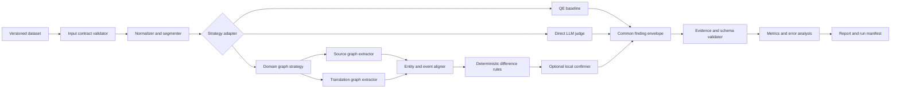

# Verification Architecture v0.1

- 작성일: 2026-10-12
- 상태: 실험 설계 초안
- 연동 상태: DARI 앱 및 기존 로컬 서버와 미연동

## 1. 문제 정의

입력은 사용자가 확인한 모국어 초안 `S`와 그 초안을 한국어 또는 영어로 옮긴 번역문 `T`다. 출력은 두 문서가 비슷하다는 점수가 아니라 다음 질문에 답할 수 있는 검증 기록이어야 한다.

> `S`에 있는 사건·인물·역할·부정·불확실성·정보 출처·시간 관계가 `T`에서도 유지되는가?

검증 시스템은 의미 변화 후보를 찾는 도구다. 진술이 사실인지, 법적으로 충분한지, 신청자에게 유리한지 판단하지 않는다.

## 2. 아키텍처가 검증해야 하는 가설

1. 서로 다른 검증 방식을 같은 계약으로 교체해 비교할 수 있다.
2. 원문과 번역문을 독립적으로 구조화하면 한쪽 표현을 다른 쪽에 억지로 맞추는 오류를 줄일 수 있다.
3. 일반 QE가 놓치는 관계 변화를 domain graph가 추가로 찾을 수 있다.
4. graph 차이를 원문 근거에서 다시 확인하면 graph 방식의 오탐을 줄일 수 있다.
5. 모델이나 parser가 실패해도 시스템이 이를 `문제 없음`으로 보고하지 않는다.
6. 결과만으로 어느 구성 요소가 어떤 판단을 만들었는지 재현할 수 있다.

## 3. 시스템 경계

### 포함

- 합성 또는 적법하게 비식별화된 문장쌍 로딩
- 문장·문단 단위 분할과 원래 문자 offset 보존
- 교체 가능한 검증 strategy 실행
- 근거 span 검증과 중복 finding 병합
- gold annotation과 결과 비교
- 실행 manifest와 집계 지표 생성

### 제외

- DARI 화면, API 또는 모바일 plugin 변경
- 번역 생성
- 난민 신청서 작성 또는 개선
- 신빙성·법적 판단
- 실제 개인 정보의 저장, 전송 또는 로그 기록
- 자동으로 사용자 원문이나 번역문을 수정하는 기능

## 4. 전체 구조

각 strategy는 독립 실행한다. 여러 strategy의 결과를 합치는 ensemble은 각 방식의 단독 성능과 실패 유형을 확인한 뒤 별도의 실험으로 추가한다.

## 5. 공통 계약

### 5.1 입력

입력은 [input.schema.json](schemas/input.schema.json)을 따른다.

| 필드 | 의미 |
| --- | --- |
| `schema_version` | 계약 버전. 초기값 `1.0` |
| `case_id` | 텍스트 내용과 무관한 안정적인 사례 ID |
| `source` | 모국어 문서, 언어 코드, 정확한 원문 |
| `translation` | 비교할 번역문, 언어 코드, 정확한 원문 |
| `data_classification` | `synthetic` 또는 승인된 비식별 연구 자료 |
| `context` | 문항 ID처럼 비교에 필요한 최소 문맥. 정답이나 오류 힌트는 넣지 않음 |

strategy에는 gold annotation을 전달하지 않는다. 평가 runner만 예측과 gold를 나중에 비교한다.

### 5.2 출력 상태

| 상태 | 의미 |
| --- | --- |
| `completed` | 모든 단계가 완료되었고 material finding이 없음 |
| `issues_found` | 모든 단계가 완료되었고 하나 이상의 finding이 있음 |
| `indeterminate` | parser, 모델, 지원 언어 또는 계약 문제로 판단할 수 없음 |
| `invalid_input` | 입력이 계약을 만족하지 않음 |

상태 우선순위는 `invalid_input > indeterminate > issues_found > completed`다. `candidate`와 `confirmed`는 active finding이고, `rejected`는 active finding이 아니다. 하나라도 `abstained`가 있으면 결과는 오류가 포함된 `indeterminate`다. 빈 `findings` 배열은 pipeline이 정상 완료된 경우에만 `completed`로 해석한다. 구성 요소 오류, timeout, malformed output은 반드시 `indeterminate`와 구조화된 오류를 반환한다.

### 5.3 Finding

모든 방식의 결과는 [report.schema.json](schemas/report.schema.json)의 공통 finding으로 변환한다.

| 필드 | 의미 |
| --- | --- |
| `type` | 안정적인 오류 유형 code |
| `change` | `added`, `removed`, `changed`, `swapped` |
| `severity` | 의미 보존 관점의 `low`, `medium`, `high`, `critical` |
| `source_span` | 원문의 문자 범위와 인용문. 없으면 `null` |
| `translation_span` | 번역문의 문자 범위와 인용문. 없으면 `null` |
| `evidence_absence_reason` | 한쪽 span이 존재할 수 없는 이유. 양쪽 span이 있으면 `null` |
| `confidence` | strategy 내부 confidence. 방식 사이의 절대 비교에는 사용하지 않음 |
| `status` | `candidate`, `confirmed`, `rejected`, `abstained` |
| `detectors` | finding을 만든 모든 구성 요소의 ID, 버전, 선택적 config·prompt·model digest |
| `rationale` | 관계 차이에 대한 짧고 중립적인 설명 |

`유리하게 강화`, `불리하게 약화` 같은 신청 결과 방향은 protocol 값으로 사용하지 않는다. 시스템은 `행위자 교체`, `부정 삭제`, `불확실성 삭제`처럼 관찰 가능한 의미 변화만 기록한다. 법적 영향이 필요하면 별도의 사람 검토 단계에서 다룬다.

## 6. 오류 분류 v0.1

| Code | 확인할 변화 | 예시 |
| --- | --- | --- |
| `omission` | source 의미 단위가 translation에 없음 | 위협 사건 전체 누락 |
| `unsupported_addition` | source에 없는 의미 단위가 추가됨 | 무기 또는 반복 행위 추가 |
| `negation_flip` | 부정·긍정 극성이 바뀜 | `보지 못했다` -> `보았다` |
| `certainty_shift` | 추정·가능성·확실성의 강도가 바뀜 | `경찰인 것 같았다` -> `경찰이었다` |
| `source_attribution_change` | 직접 경험·전언·추론의 출처가 바뀜 | `어머니에게 들었다` -> `내가 보았다` |
| `actor_role_change` | 행위자·대상·피해자 역할이 바뀜 | 형이 신청자를 위협 -> 신청자가 형을 위협 |
| `identity_value_change` | 인물·집단·장소·수치·날짜가 바뀜 | 2022년 -> 2023년 |
| `temporal_change` | 사건 순서·기간·빈도가 바뀜 | 한 번 -> 반복적으로 |
| `causality_change` | 원인·목적·동기가 추가·삭제·변경됨 | `그래서 떠났다` 관계 삭제 |
| `harm_strength_change` | 위협·피해·강요 정도가 달라짐 | 밀었다 -> 심하게 폭행했다 |

한 변화가 여러 유형에 해당하면 가장 구체적인 primary type 하나와 `related_types`를 기록한다. 동일 근거와 같은 의미 단위를 가리키는 finding은 결정적인 key로 병합한다.

## 7. Domain event graph

Graph 방식은 완전한 범용 AMR을 먼저 구현하지 않는다. DARI에서 중요한 의미를 최소 schema로 표현한다.

### Node

- `entity`: 사람, 집단, 기관, 장소와 지칭 표현
- `event`: 행위, 상태, 위협, 이동, 체포 등
- 각 node는 원래 문서의 하나 이상의 evidence span을 가진다.

### Edge

- 역할: `ACTOR`, `TARGET`, `EXPERIENCER`, `SOURCE`
- 시간: `BEFORE`, `AFTER`, `DURING`
- 담화: `CAUSES`, `PURPOSE`, `REPORTS`
- 위치·시간 값: `AT_LOCATION`, `AT_TIME`

### Attribute

- `polarity`: affirmative / negative
- `certainty`: certain / probable / possible / unknown
- `evidence_source`: direct / reported / inferred / unknown
- `frequency`, `time_expression`, `harm_level`

불확실성과 정보 출처는 event 전체가 아니라 해당 node, edge 또는 attribute에 붙인다. 예를 들어 `경찰인 것 같은 사람이 체포했다`의 불확실성은 체포 여부가 아니라 행위자 신분에 연결되어야 한다.

## 8. Strategy 경계

### `qe_baseline`

reference-free QE 또는 오류 span 모델을 공통 finding으로 변환한다. 일반 QE의 역할은 강한 baseline 제공이며, DARI taxonomy 전체를 설명한다고 가정하지 않는다.

### `direct_judge`

현재 방식과 유사하게 전체 문장쌍을 직접 비교한다. 출력 JSON은 엄격하게 검증하고, prompt와 model revision을 manifest에 기록한다. 입력 텍스트 안의 지시문은 data로 인용하며 system instruction으로 실행하지 않는다.

### `domain_graph`

1. `S`만 보고 source graph를 추출한다.
2. `T`만 보고 translation graph를 추출한다.
3. 같은 인물과 같은 사건 후보를 정렬한다.
4. discrete relation과 attribute를 deterministic rule로 비교한다.
5. 차이가 난 graph element를 evidence span으로 되돌린다.

Extractor API는 문서 하나만 받는다. 이 함수 signature 자체로 반대편 문서에 대한 정보 누출을 막는다.

### `graph_confirmed`

Graph 차이 하나에 필요한 국소 문장과 질문만 별도 confirmer에 전달한다. Confirmer는 새 오류를 자유롭게 생성하지 않고 candidate를 `confirmed`, `rejected`, `abstained` 중 하나로 바꾼다.

## 9. Evidence와 provenance

- v1의 모든 span은 Python 문자열의 Unicode code point offset을 기준으로 한다. JavaScript adapter는 UTF-16 code unit index를 그대로 저장하지 않고 code point offset으로 변환한다.
- runner는 저장 전에 `text[start:end] == quote`를 검증한다.
- v1의 단일 문서 단위 ID는 원문 `source:0`, 번역문 `translation:0`으로 고정한다.
- `omission`은 source-only span과 부재 이유, `unsupported_addition`은 translation-only span과 부재 이유를 가진다. 나머지 type은 양쪽 span을 가진다.
- 정규화된 텍스트만 저장하지 않고 원문과 offset mapping을 유지한다.
- component에는 detector ID와 버전, model revision, prompt hash, config hash를 남긴다.
- provenance에는 dataset version과 canonical content digest, Git commit, random seed, 시작 시각, 실행 시간, hardware class를 남긴다.
- `experiment_fingerprint`는 dataset content digest·code·strategy·config의 정적 identity이며 시각과 실행 시간은 포함하지 않는다. `run_id`는 실행마다 별도로 생성한다.
- 기본 로그와 집계 결과에는 원문을 남기지 않는다.

## 10. 실패 격리

| 실패 | 결과 |
| --- | --- |
| 입력 schema 오류 | `invalid_input` |
| 지원하지 않는 언어 | `indeterminate` + `unsupported_language` |
| extractor 하나가 실패 | 해당 strategy 전체 `indeterminate` |
| aligner confidence 부족 | 관련 항목 `abstained`; 전체 판단 가능 여부도 기록 |
| model timeout 또는 malformed JSON | `indeterminate`; 빈 finding으로 대체 금지 |
| evidence span 불일치 | 해당 case `indeterminate` + `evidence_mismatch` |
| 일부 case만 실패 | 다른 case는 계속 실행하고 실패율을 지표로 집계 |

## 11. 현재 저장소와의 관계

현재 검증 관련 코드는 `local_verification_server.py`와 이전 화면 경로에 남아 있지만, 새 웹 메인 흐름에는 연결되어 있지 않다. 실험 단계에서는 다음 파일을 변경하지 않는다.

- `local_verification_server.py`
- `capacitor-web/src/lib/api.ts`
- `capacitor-web/src/LegacyApp.tsx`
- `app/src/main/java/org/dari/mvp/VerificationRepository.kt`

실험 결과가 통과한 뒤에도 바로 연결하지 않는다. 먼저 선택한 strategy를 순수 library로 고정하고, API adapter와 UI adapter는 그 다음 단계에서 별도로 설계한다.

## 12. 연동을 논의할 수 있는 최소 조건

1. 공통 schema와 failure semantics가 고정됨
2. 합성 mutation suite와 bilingual gold pilot 결과가 재현됨
3. 가장 강한 baseline 대비 domain 방식의 이득과 비용이 수치로 확인됨
4. high-severity false negative가 개별 검토됨
5. evidence span이 사람 검토에 충분하다는 평가를 받음
6. 개인정보 저장·로그 정책과 on-device/server 경계가 별도로 승인됨
7. 사용자에게 자동 판정이 아닌 확인 후보로 제시하는 UX가 검토됨

## 13. 아직 열려 있는 결정

- 첫 bilingual gold set의 언어쌍과 검수자
- `critical` severity의 정확한 정의
- graph extractor를 규칙, SRL/AMR parser, LLM 중 무엇으로 시작할지
- cross-lingual graph node alignment에 사용할 표현
- confirmer가 source와 translation을 동시에 볼 수 있는 범위
- on-device 제약을 아키텍처 평가에 언제 포함할지
- dataset과 결과 artifact를 보관할 비공개 위치
