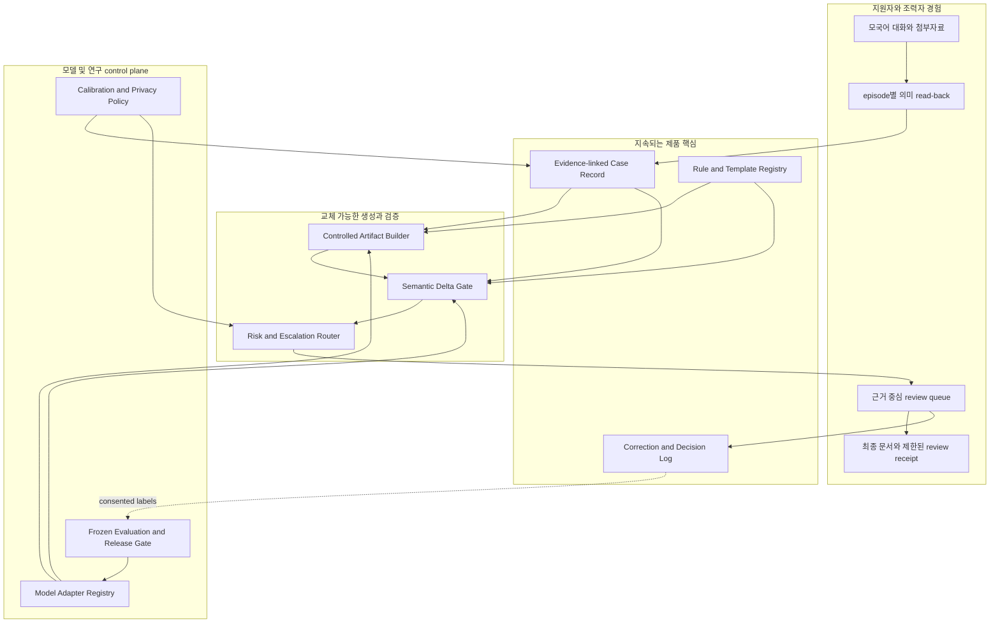

# DARI 검증 아키텍처 v0.4

- 작성일: 2026-10-17
- 상태: 서비스 및 연구 방향 재설계
- 대상 브랜치: `experiment/verification-architecture`
- 제품 연동 상태: 미연동 연구 sidecar

## 1. 이번 설계의 결론

**DARI는 더 좋은 번역기나 LLM 검사기가 아니라, 지원자가 확인한 중요한 진술을 원문부터 최종 문서까지 근거와 함께 연결하고 의미가 바뀐 지점만 지원자 또는 허가된 조력자가 검토하게 하는 applicant-controlled multilingual integrity layer로 설계한다.**

모델이 좋아질수록 번역, 추출, JSON 생성, 문단 이해와 일반적인 self-check는 빠르게 범용 기능이 된다. 따라서 DARI의 장기 가치는 모델의 현재 약점에 의존하면 안 된다. 모델 밖에 남는 다음 자산이 중심이어야 한다.

1. 지원자가 자기 언어로 확인한 claim과 정확한 원문 근거
2. 한국 난민신청 절차와 문항에 맞춘 Semantic Contract
3. 원문, claim, 초안, 수정, 최종본을 연결하는 revision lineage
4. 오류 유형, 언어, 문서 단계별 검수 기준과 calibration
5. 지원자와 통역가, 활동가, 법률지원자가 함께 검토하는 업무흐름
6. 모델 교체 때마다 같은 평가를 다시 실행하는 release gate

Graph는 행위자와 대상, 전언, 확실성의 적용 범위, 사건 순서처럼 관계가 중요한 오류에만 쓰는 선택적 도구다. 제품의 해자나 기본 화면이 아니다.

## 2. v0.3에서 바꾼 큰 결정

| v0.3 | v0.4 결정 | 이유 |
| --- | --- | --- |
| 검출 파이프라인이 아키텍처의 중심 | `Evidence-linked Case Record`와 검토 업무흐름이 중심 | 검출기는 더 좋은 기반 모델로 대체될 수 있지만 확인 기록과 계보는 남음 |
| confirmed fact를 한 번에 확인 | 사건 또는 episode 단위 의미 read-back과 상태 기록 | 현재의 단일 checkbox는 중요한 claim을 실제로 확인했다는 근거가 약함 |
| 초안 생성 뒤 검증을 주로 상정 | 생성 전 제약, 생성 뒤 delta gate를 함께 사용 | 오류를 만든 뒤 찾는 것보다 허용된 claim만 사용하게 하는 편이 우선 |
| 수정본은 별도 text로 저장 가능 | 모든 적용 및 수동 수정 뒤 claim coverage를 재계산 | 현재 제품에서 직접 고친 문장이 원문 근거와 끊기는 경계가 가장 위험함 |
| correction lineage를 데이터 해자로 설명 | 최소 수집, 암호화, 접근 통제, 삭제 가능, 제한된 export | 민감한 정정 이력은 자산이기 전에 사용자 위험이 될 수 있음 |
| graph와 verifier의 성능을 주 연구 질문으로 둠 | 모델 교체 후에도 잔존 오류와 검수 시간을 줄이는지 검증 | 더 강한 LLM이 등장해도 유효한 주장이어야 함 |
| claimant-only 도구에 가까움 | 지원자와 허가된 조력자의 B2B2C 공동 검토 | 고위험 언어 및 법률지원에는 인간 이관과 책임 주체가 필요함 |

## 3. 자동으로 보장할 수 있는 범위

검증이라는 말을 세 층으로 분리한다.

| 층 | 질문 | DARI의 역할 |
| --- | --- | --- |
| 의미 충실성 | 확인한 claim이 후속 문서에 보존됐는가 | 제품 핵심, 자동 검출과 선택적 사람 검토 |
| 기록 무결성 | 어떤 원본, revision, 모델, 검토에서 나온 결과인가 | hash, ID, access log와 review receipt로 지원 |
| 법적 타당성 | 법적으로 충분하고 유리하며 신빙성이 있는가 | 자동 판정하지 않고 자격 있는 조력자에게 이관 |

`user_confirmed`는 객관적 진실이 확인됐다는 뜻이 아니다. 해당 시점에 지원자가 자신의 의도가 그렇게 표현됐다고 확인했다는 뜻이다. 진술의 신빙성, 난민 인정 가능성, 법적 유불리를 자동으로 분류하지 않는다.

## 4. 두 개의 기준 정보 영역

DARI는 지원자의 사건 내용과 외부 법률 정보를 하나의 지식 그래프에 섞지 않는다.

### A. Evidence-linked Case Record

지원자의 원문과 의도에 대한 기준이다.

```text
episode_id, claim_id, revision
source_language, evidence_span, optional_media_ref
subject, predicate, object_or_value
polarity, certainty, evidentiality, time, location
state = asserted | clarified | user_confirmed | uncertain |
        corrected | withdrawn | professionally_reviewed
supersedes[], created_by, confirmed_by, confirmation_method
consent_scope, retention_policy
```

이 기록은 지원자가 통제한다. 철회된 claim은 후속 문서 생성에서 제외하지만, 내부 보관 여부와 기간은 동의와 운영 정책에 따른다. 외부 기관에 전달하는 기본 export에는 원시 대화와 전체 정정 이력을 넣지 않는다.

### B. Rule and Template Registry

공식 서식, 문항, 작성 규칙과 전문가가 승인한 설명의 기준이다.

```text
template_id, version, jurisdiction, effective_date
question_id, required_claim_types, optional_claim_types
forbidden_states, allowed_transformations
official_source, reviewer, review_date
```

두 영역의 출처와 책임 주체를 분리해야 지원자의 진술과 법률적 안내가 섞이는 것을 막을 수 있다.

## 5. 전체 구조



제품 흐름은 `원문 -> 확인된 사건기록 -> 제약된 문서 생성 -> 의미 delta 검수 -> 사람 검토 -> 최소화된 export`다. 모델은 이 흐름의 공급자이고, 사건기록과 검토 결정이 기준이다.

## 6. 모듈의 입력과 출력

| 모듈 | 입력 | 출력 | 핵심 책임 |
| --- | --- | --- | --- |
| P0 Capture and Episode Builder | 모국어 text/voice, 문항 맥락, 첨부자료 | evidence span, episode, candidate claim, ambiguity | 사건을 claim 묶음으로 나누되 해석 불가능한 부분을 숨기지 않음 |
| P1 Meaning Read-back | episode, candidate claims, source-language renderer | claim별 `confirmed/uncertain/corrected/withdrawn` 결정 | 사용자가 이해하는 언어로 의미를 다시 보여주고 실질적 확인을 기록 |
| P2 Case Record Store | read-back 결정, evidence, revision, consent | versioned Evidence-linked Case Record | 현재 기준 claim과 수정 계보, 접근 및 보관 정책을 유지 |
| P3 Artifact Builder | active claims, Semantic Contract, model adapter | 문장, claim IDs, model/prompt/version, unresolved items | 허용된 claim만 사용해 초안 또는 번역을 만들고 문장별 근거를 연결 |
| P4 Semantic Delta Gate | 기준 claims, 생성 또는 수정 artifact, prior revision | added/removed/changed/unclear delta와 evidence | 매 생성, 적용, 수동 편집 뒤 의미 변화를 다시 계산 |
| P5 Assurance Cascade | delta, risk, detector confidence, language calibration | pass, review, human escalation, abstain | 가장 싼 신뢰 가능한 검사부터 실행하고 불확실하면 멈춤 |
| P6 Evidence Review | 양쪽 evidence, plain-language change, reviewer role | accept, reject, correct, defer 결정 | graph가 아니라 무엇이 어떻게 바뀌었는지를 판단 가능하게 제시 |
| P7 Export and Handoff | final artifact, active claims, review decisions, policy | 제출 초안, portable case packet, 제한된 receipt | 필요한 내용만 역할별로 내보내고 내부 원시 이력은 기본 제외 |
| C0 Model Adapter Registry | provider/model/version/config | 표준화된 generation/extraction/judge interface | 특정 모델 종속을 막고 실행 정보를 기록 |
| C1 Evaluation and Release Gate | frozen set, ecological set, candidate model | scorecard, regression report, deploy decision | 새 모델을 자동 승격하지 않고 기존 기준보다 나은지 확인 |
| C2 Calibration and Policy | 언어/오류/단계별 결과, 비용, 검토 용량 | threshold, abstention, escalation rule | confidence를 실제 위험과 검토 자원에 맞춤 |

## 7. Assurance Cascade

모든 문장을 여러 모델로 반복 검사하지 않는다. 위험과 불확실성에 따라 다음 순서로 올린다.

1. **Deterministic invariant**: claim coverage, 숫자, 날짜, 이름, 명시적 부정, 철회된 값 재등장
2. **Flat claim entailment 또는 direct judge**: 일반적인 의미 누락과 추가
3. **Relational micrograph plugin**: 행위자-대상, 전언, 확실성 scope, 사건 순서
4. **독립 verifier**: 생성기와 다른 계열의 모델 또는 다른 증거 경로
5. **인간 이관**: 중요한데 불확실하거나 언어별 calibration 범위를 벗어난 항목

동일한 모델에 같은 정보를 다시 물은 self-check는 독립 검증으로 계산하지 않는다. 자동 역번역도 지원자의 이해를 돕는 read-back일 수는 있지만 독립적인 정확성 증거는 아니다.

Finding은 `유리/불리`를 추정하지 않고 다음만 보여준다.

```text
claim_id, artifact_revision, type = added | removed | changed | unclear
risk = critical | high | medium | low
source_evidence[], artifact_evidence[]
plain_language_delta
detector, model_family, confidence, calibration_group
status = open | accepted | rejected | corrected | deferred
```

## 8. 지금 가장 먼저 검증할 경계

첫 연구 범위는 `confirmed facts -> Korean draft -> applicant edits -> final Korean export`로 고정한다.

현재 제품은 수집된 fact 전체를 하나의 checkbox로 확인하고, 직접 고친 문장은 원문 근거에 자동으로 다시 연결하지 않는다. 또한 영어 UI에서만 한국어 초안의 영어 meaning view가 보이고 다른 대상 언어 사용자가 최종 문장을 자기 언어로 확인하는 경로는 충분하지 않다. 따라서 가장 가치가 큰 경계는 다음 세 곳이다.

1. episode별 fact 확인이 실제 사용자 의도를 반영하는가
2. 초안 생성이 active confirmed claim과 Semantic Contract를 지키는가
3. 생성 뒤 수정이나 재생성으로 근거 연결이 끊기거나 철회된 사실이 되살아나는가

이 경계가 검증되기 전에는 cross-lingual V3나 범용 번역 검사를 제품 핵심으로 확장하지 않는다.

## 9. LLM 발전을 흡수하는 구조

새 모델은 위협이면서 더 좋은 부품이다. 모델이 개선되면 adapter 뒤의 생성기, 추출기, judge를 교체하고 Evidence-linked Case Record는 그대로 유지한다.

모든 실행은 다음을 남긴다.

```text
model_provider, model_family, model_version
prompt_or_policy_version, inference_config
input_artifact_digest, output_artifact_digest
claim_coverage, findings, abstention, latency, cost
```

새 모델 승격 조건은 다음과 같다.

- frozen challenge set과 자연 사례를 모두 실행
- 두 개 이상의 언어와 고위험 오류 유형별 결과 확인
- 잔존 중요 오류, 잘못된 경고, 검수 시간 중 어느 것도 허용 범위 밖으로 악화되지 않음
- privacy와 on-device/cloud 정책을 충족
- shadow run 뒤 명시적으로 release

## 10. 제품 경계와 시장 위치

| 영역 | 이미 강한 사례 | DARI의 선택 |
| --- | --- | --- |
| 실시간 통번역과 인간 네트워크 | Tarjimly, CLEAR Global | 직접 경쟁하지 않고 고위험 검수 이관 파트너로 봄 |
| 위기 정보와 양방향 상담 | Signpost, IRAP | 정보 포털보다 개별 사건 기록의 의미 계보에 집중 |
| 구조화 법률 문서 조립 | docassemble, Citizenshipworks | 자유 서술과 다국어 변환까지 이어지는 claim provenance를 담당 |
| 법률기관 case management | LegalServer | 전체 CMS를 만들지 않고 삽입 가능한 integrity layer로 연동 |
| 번역 QE와 human review | Phrase, Smartling, RWS, LILT | 평균 품질 점수보다 사건 claim 변화와 양쪽 evidence를 제시 |
| 권위 자료 기반 법률 AI | CoCounsel, UNHCR RiMAP | 법률 판단이 아니라 지원자 진술의 전달 무결성에 집중 |

검토한 사례를 기준으로 DARI가 점유할 수 있는 좁은 공백은 **한국 난민신청 과정에서 지원자의 원문 진술, 확인된 claim, 한국어 초안, 수정본, 최종본을 claim 단위로 연결하는 검수 계층**이다. 경쟁사가 없다는 주장이 아니라, 이 가설을 파트너 pilot로 검증해야 한다는 뜻이다.

## 11. 해자 후보와 해자가 아닌 것

### 축적할 가치가 있는 것

- 한국 난민신청 문항별 Semantic Contract와 전문가 review history
- 동의한 범위에서 비식별화한 `claim - delta - evidence - decision` 학습 사례
- 언어, 오류 유형, 문서 단계별 calibration과 abstention 정책
- 지원자 확인과 조력자 검토가 연결된 correction workflow
- 두 번 이상의 모델 교체를 견딘 longitudinal benchmark
- NGO, 통역가, 법률지원자와의 검토 및 배포 관계

민감한 원문 자체를 데이터 해자로 삼지 않는다. 원시 진술과 철회 이력은 최소화하고, 모델 개선에 쓰는 사례는 별도 동의, 비식별화, 접근 통제 조건을 만족해야 한다.

### 빠르게 범용화될 것

- 번역과 초안 생성
- 5W1H와 claim 추출
- LLM 기반 graph 생성
- 긴 context 처리
- 단순 self-check와 종합 quality score
- 특정 소형 모델 또는 특정 cloud model 연결
- graph viewer 자체

## 12. 연구 질문

**RQ1.** persistent user-confirmed provenance가 매번 source를 다시 parsing하는 방식보다 모델과 언어가 바뀌어도 안정적인가?

**RQ2.** controlled generation과 evidence-linked selective review가 최신 direct LLM judge보다 최종 잔존 중요 오류와 검수 시간을 줄이는가?

**RQ3.** 수정, 재생성, 번역을 거친 뒤에도 철회되거나 정정된 claim의 재등장을 막는가?

**RQ4.** 지원자와 조력자가 finding을 이해하고 올바르게 수락, 거절, 수정할 수 있는가?

**RQ5.** relational micrograph가 flat claim 방식보다 관계 오류에서만이라도 실질적인 추가 가치를 주는가?

연구의 가장 강한 주장은 새로운 graph 표현이 아니라 **사용자 확인 provenance를 이용한 생성과 검토가 기반 모델 발전 뒤에도 case export의 잔존 위험과 사람 시간을 줄인다**가 되어야 한다.

## 13. 성공, 전환, 중단 기준

수치는 pilot 전에 사전 등록하며 다음은 초기 기준이다.

### Go

- 최신 frontier direct baseline과 같은 검토 부담에서 최종 잔존 critical/high 오류를 25% 이상 줄임
- 또는 같은 잔존 오류 수준에서 조력자 검토 시간을 20% 이상 줄임
- claim provenance coverage 95% 이상, 철회된 claim 재등장률 1% 미만
- 두 개 이상 언어, 두 모델 계열에서 효과 방향이 유지됨

### Pivot

- verifier 이점은 사라졌지만 evidence lineage가 검토 시간과 인계 품질을 개선함
- 이 경우 별도 검출 연구를 줄이고 case record, read-back, export, review receipt에 집중
- graph가 flat claim보다 관계 오류 recall을 8%p 이상 높이지 못하면 runtime에서 제거

### Kill

- 최신 모델과 단순 source-linked prompt가 같은 부담에서 비열등하고 lineage UI도 검토 시간을 줄이지 못함
- 조력자가 evidence view를 사용하지 않거나 잘못된 수정을 더 많이 유도함
- 두 번의 주요 모델 교체에서 추가 효과가 반복해서 사라짐
- 실제 사용자와 파트너가 portable case record 또는 review receipt에 가치를 느끼지 않음

## 14. 구현 순서

1. 현재 fact 확인을 episode별 모국어 read-back과 claim 상태로 바꾼다.
2. 직접 수정과 제안 적용 뒤 문장별 claim coverage와 unresolved delta를 다시 계산한다.
3. 최종 문장을 대상 원언어로 확인하고 고위험 불확실성은 인간에게 이관한다.
4. final export에는 필요한 artifact와 제한된 receipt만 넣는 정책을 만든다.
5. current UI, 최신 direct judge, provenance-aware gate, 이중언어 human review를 같은 case export 단위에서 비교한다.
6. 위 비교를 통과한 뒤에만 cross-lingual translation stage와 선택적 micrograph를 확장한다.

## 15. 현재 demo의 의미

현재 `graph_demo.py`와 viewer는 hand-authored graph와 scripted alignment를 이용해 role, polarity, certainty, attribution, temporal delta를 시각화한다. 이는 relation-aware finding과 evidence trace가 표현 가능하다는 증거다.

자동 claim extraction, 실제 사용자 확인의 타당성, 자연 발생 오류 성능, 검수 시간 절감, 모델 교체 내성은 아직 증명되지 않았다. v0.4의 가치는 문서에 제시된 가설이며, 파트너와 사용자 연구를 거쳐야 제품 또는 연구 성과로 주장할 수 있다.

## 16. 주요 외부 근거

- [Tarjimly FirstPass](https://www.tarjimly.org/firstpass-landing): AI 초벌번역, 인간 수정, 저자원 언어 feedback loop
- [Signpost](https://www.signpost.ngo/home): 지역 기반 정보, 양방향 지원, 커뮤니티 운영
- [UNHCR RiMAP](https://www.unhcr.org/innovation/project/rimap-ai-virtual-assistant-refugee-law-support-protection): 권위 자료, 정확한 인용, 법률가 검증
- [LegalServer Intake](https://www.legalserver.org/features/intake/): 법률구조기관 intake와 case workflow
- [docassemble](https://docassemble.org/): 구조화 답변을 이용한 문서 조립
- [CoCounsel Legal](https://legal.thomsonreuters.com/en/legal/draft-review-analysis-corp): 신뢰 자료, source attribution, 기존 업무흐름 통합
- [WMT25 Automated Translation Evaluation](https://aclanthology.org/2025.wmt-1.24/): segment와 span 수준 오류 검출의 지속적인 어려움
- [ACES and SPAN-ACES](https://aclanthology.org/2025.cl-1.4/): 평균 점수보다 오류 유형별 challenge set의 필요성
- [Stanford AI Index 2025](https://hai.stanford.edu/ai-index/2025-ai-index-report): 모델 성능과 비용의 빠른 범용화
- [C2PA Explainer](https://spec.c2pa.org/specifications/specifications/2.4/explainer/Explainer.html): provenance와 내용의 진실성 구분
