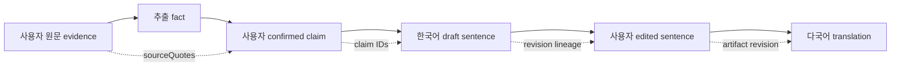
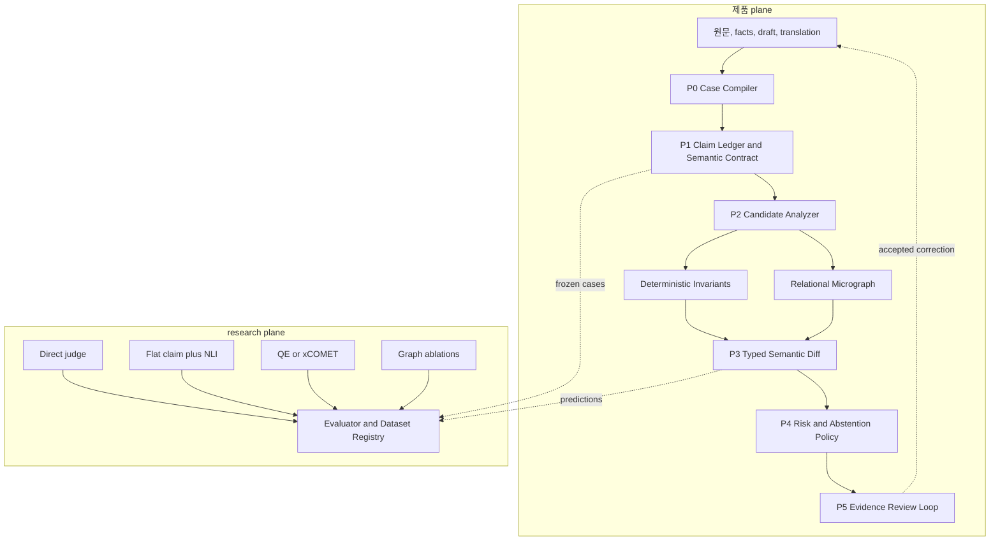
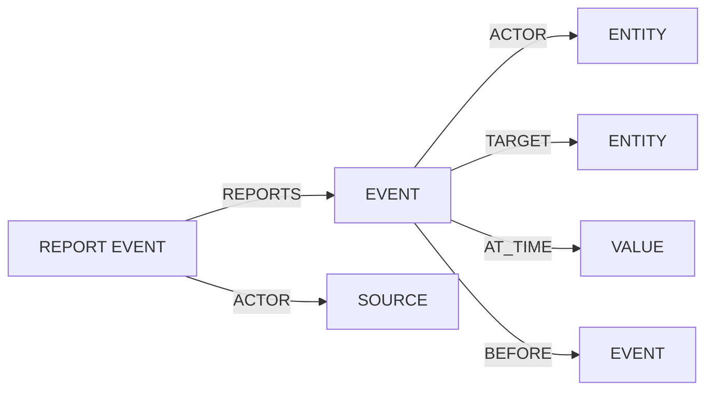

# DARI 검증 아키텍처 v0.3

- 작성일: 2026-10-17
- 상태: 구현 전 설계 기준
- 대상 브랜치: `experiment/verification-architecture`
- 제품 연동 상태: 미연동 연구 sidecar

## 1. 한 문장 결론

**DARI는 두 문서를 막연히 비교하는 번역 평가기가 아니라, 사용자가 확인한 claim과 원문 근거가 사실 추출, 초안, 수정, 번역 과정에서 보존되는지를 추적하는 provenance-aware semantic diff system으로 설계한다.**

이 시스템은 외부 세계의 진실이나 법률적 타당성을 판정하지 않는다. 보장하려는 것은 다음 두 가지다.

1. 사용자가 확인한 의미가 downstream artifact에서 바뀌지 않았는가.
2. 바뀌었다면 어떤 claim이 어느 단계에서 바뀌었고, 그 판단 근거는 무엇인가.

## 2. v0.2에서 바꾼 핵심 결정

| 기존 방향 | v0.3 결정 | 이유 |
| --- | --- | --- |
| source와 candidate를 매번 각각 full graph로 추출 | 사용자 확인 fact를 `Claim Ledger`로 고정하고 candidate만 주로 분석 | reference 재추출 오류와 비용을 줄이고 DARI의 구조화 정보를 활용 |
| graph가 전체 검증의 중심 | graph는 관계 오류를 다루는 선택적 `Relational Micrograph` | 숫자, 날짜, 명시적 부정, 누락은 더 단순한 방법이 안정적 |
| V1, V2, V3를 동시에 구현 | V2 `confirmed fact -> Korean draft`를 첫 제품 경계로 선택 | 같은 언어에서 핵심 가설을 먼저 검증할 수 있음 |
| QE, direct judge, graph를 runtime에서 병렬 orchestration | baseline은 research plane에서 독립 실행 | 제품 복잡도를 줄이고 각 방법의 실제 기여를 분리 |
| macro-F1 중심 | 고위험 오류 recall, 문서당 오탐, 검수 시간, 잔존 오류 중심 | 실제 사용자 impact와 직접 연결 |
| graph 구조 자체를 차별점으로 설명 | provenance, correction data, calibration을 해자 후보로 정의 | graph와 prompt는 공개 기술로 복제 가능 |

## 3. 제품에서 지켜야 할 의미 계보



각 화살표는 서로 다른 검증 문제다.

| 단계 | 검증 질문 | 주된 실패 |
| --- | --- | --- |
| V1 원문 -> fact | 원문이 fact로 정확히 구조화됐는가 | 추출 누락, 잘못된 값, 출처·확실성 왜곡 |
| V2 confirmed claim -> draft | 확인한 의미가 초안에 보존됐는가 | 누락, 단정 강화, 행위자 교체, 정정 전 값 재사용 |
| V3 final draft -> translation | 언어 변환 중 의미가 보존됐는가 | 부정·역할·시간·출처·수치 변화 |

세 단계를 같은 알고리즘으로 억지로 통일하지 않는다. 대신 모든 결과가 같은 `claim_id`, `revision`, `evidence`를 이어받는 **semantic chain of custody**로 통일한다.

## 4. 전체 구조



제품 plane은 선택된 방법 하나만 실행한다. research plane은 같은 frozen data에서 여러 방법을 독립 비교한다. 성능 근거 없이 여러 detector를 합치지 않는다.

## 5. 핵심 artifact

### 5.1 Evidence Ledger

사용자 발화와 정확한 원문 범위를 보존한다.

```text
message_id, revision, language, text
evidence_span = {message_id, start, end, quote}
```

### 5.2 Canonical Claim Ledger

사용자가 확인한 의미를 비교 기준으로 고정한다. 현재 제품의 `requirementId`, `eventId`, `certainty`, `knowledge`, `sourceQuotes`, `supersedes`, `confirmed`를 활용한다.

```text
claim_id
event_id
subject, predicate, object or value
polarity, certainty, evidentiality
time, location, frequency
source_evidence[]
confirmation_state
supersedes[]
revision
```

Claim Ledger는 세계의 진실이 아니라 **사용자가 확인한 현재 기준**이다. 사용자가 fact를 수정하면 새 revision이 생기고 이전 검증 결과는 stale 상태가 된다.

### 5.3 Semantic Contract

artifact마다 모든 claim이 반드시 들어가야 하는 것은 아니다. 문항과 문서 단계에 따라 필요한 의미를 명시한다.

```text
contract_id, stage, target_section
required_claim_ids[]
optional_claim_ids[]
forbidden_superseded_claim_ids[]
risk_weights
allowed_transformations
```

이 계약이 없으면 정상적인 요약이나 문항별 선택까지 omission으로 잘못 경고하게 된다.

### 5.4 Candidate Semantic Artifact

초안 또는 번역문에서 관찰된 claim과 관계를 담는다. 모든 요소는 candidate text의 evidence span을 가진다.

### 5.5 Finding

```text
finding_id, claim_id, type, risk
reference_evidence[], candidate_evidence[]
observed_change
detector, confidence, calibration_group
status = candidate | confirmed | rejected | abstained
```

## 6. 실행 모듈의 입력과 출력

| 모듈 | 입력 | 출력 | 책임 |
| --- | --- | --- | --- |
| P0 Case Compiler | 제품 artifact, revision, digest, stage | `VerificationCaseV2` | stale artifact와 잘못된 연결을 모델 호출 전에 제거 |
| P1 Claim Ledger Compiler | confirmed facts, sourceQuotes, corrections | `ClaimLedger` | reference 의미를 가능한 한 결정론적으로 구성 |
| P1 Semantic Contract Projector | claim ledger, question/section, stage | `SemanticContract` | 이번 artifact가 보존해야 할 claim 범위를 정함 |
| P2 Candidate Analyzer | candidate text, sentence `factIds`, language | candidate claims, coverage | candidate만 보고 claim을 추출하고 anchor 후보를 만듦 |
| P3 Typed Semantic Diff | contract, reference claims, candidate claims | candidate findings | claim 정렬 후 관찰 가능한 의미 차이를 분류 |
| P4 Risk and Abstention Policy | findings, confidence, coverage, calibration | review queue 또는 통과 | 위험과 불확실성에 따라 자동 통과·검토·보류 |
| P5 Evidence Review Loop | finding과 양쪽 evidence | accepted/rejected/corrected decision | 사람이 빠르게 판단하고 수정하도록 지원 |
| Offline Evaluator | frozen gold set, 각 strategy 결과, 비용 | scorecard, go/pivot/kill | 기술 가치와 제품 impact를 독립 평가 |

## 7. 각 모듈의 설계

### P0. Case Compiler

기존 revision, digest, evidence span, fact ID 검사를 하나의 입구로 묶는다.

- V2에서는 사용자 확인이 끝난 fact snapshot만 reference로 허용한다.
- candidate draft가 어떤 fact revision에서 생성됐는지 확인한다.
- sourceQuote가 실제 사용자 메시지의 substring인지 확인한다.
- 정정으로 폐기된 fact가 active reference에 포함되지 않게 한다.
- 실패하면 의미 모델을 호출하지 않는다.

### P1. Claim Ledger Compiler와 Semantic Contract

reference 쪽을 자유 텍스트 LLM으로 다시 해석하지 않는다. 현재 DARI 데이터에서 결정 가능한 내용은 deterministic projector로 만든다.

- `requirementId + eventId`는 claim과 event의 안정적인 anchor다.
- `certainty`는 확실성 qualifier가 된다.
- `knowledge`는 direct, reported, inferred provenance가 된다.
- `supersedes`는 정정 계보가 된다.
- `sourceQuotes`는 사용자가 확인할 수 있는 근거가 된다.

자유 서술값에서 주체·대상 관계를 더 추출해야 할 때만 제한적으로 모델을 사용하고, 그 결과는 `model_extracted`로 구분한다.

### P2. Candidate Analyzer

candidate text만 보고 의미를 추출한다. reference의 정답 구조를 보여주지 않는다.

초기 구현에서는 다음 두 경로를 함께 사용한다.

1. **Deterministic invariant path**: fact ID coverage, 숫자, 날짜, 이름, 명시적 부정, 정정 전 값.
2. **Candidate claim extraction path**: predicate, participant role, certainty, source attribution, temporal relation.

문장에 붙은 `factIds`는 alignment 후보를 줄이는 anchor일 뿐, 그 문장이 fact 의미를 실제로 보존했다는 증거로 간주하지 않는다.

### P3. Typed Semantic Diff

MVP 오류 유형은 일곱 개로 제한한다.

| Type | 판정 대상 | 기본 경로 |
| --- | --- | --- |
| `omission` | required claim이 candidate에 없음 | contract coverage |
| `actor_role_change` | 같은 사건의 주체·대상이 바뀜 | micrograph |
| `negation_flip` | claim polarity가 바뀜 | deterministic + claim |
| `certainty_shift` | 가능·추정·확정의 범위나 강도가 바뀜 | scoped qualifier |
| `source_attribution_change` | 직접 경험·전언·추론 또는 화자가 바뀜 | reporting relation |
| `identity_value_change` | 인물·장소·날짜·수치가 바뀜 | normalized value |
| `temporal_change` | 사건 순서·기간·빈도가 바뀜 | temporal relation |

`causality_change`, `harm_strength_change`, 일반 `unsupported_addition`은 pilot의 annotation agreement와 실제 오류 빈도를 확인한 뒤 추가한다. 특히 피해 강도는 법률적 판단으로 오해될 수 있어 초기 자동 판정에서 제외한다.

### P3-A. Relational Micrograph

Graph는 다음처럼 연결 구조가 필요한 claim에만 만든다.



전체 문단을 하나의 거대한 AMR로 만들지 않는다. 필요한 event 주변의 작은 subgraph를 만들고 claim 단위로 비교한다. Embedding은 후보를 찾는 데만 사용하고 역할, 부정, 확실성, 시간 차이의 최종 판정은 typed rule이 담당한다.

### P4. Risk and Abstention Policy

모델 confidence를 그대로 신뢰하지 않는다. calibration set에서 언어, 길이, error type별 risk-coverage를 측정한다.

- 명확한 deterministic difference는 바로 review finding으로 보낸다.
- 정렬 margin이 작거나 coverage가 낮으면 보류한다.
- 동일 base model을 같은 prompt로 다시 호출한 결과를 독립 확인으로 취급하지 않는다.
- targeted verifier는 graph-only 오탐 유형이 반복적으로 확인된 뒤에만 추가한다.

### P5. Evidence Review Loop

사용자에게는 graph 자체보다 판단 가능한 근거를 보여준다.

- 무엇이 달라졌는지 한 문장으로 설명
- 확인된 claim의 원문 evidence
- candidate의 대응 evidence
- `수정 필요`, `같은 의미`, `판단 어려움` 선택
- 수정 후 새 revision 재검증

이 판정은 동의와 비식별 정책 아래 evaluation data로 축적할 수 있다.

## 8. 연구 근거를 가져온 방식

| 연구 계열 | 가져온 아이디어 | DARI에서 바꾼 점 |
| --- | --- | --- |
| PropBank, MEANT | predicate와 semantic role 비교 | full SRL score 대신 고위험 role 차이만 typed finding으로 사용 |
| AMR, Smatch | 의미를 node와 edge로 표현 | full AMR 대신 작은 relation subgraph 사용 |
| S2MATCH, FGW | soft graph alignment 후보 | embedding은 후보 검색에만 사용하고 최종 판정에서 제외 |
| COMETKiwi, xCOMET | reference-free QE와 error span | 제품 core가 아닌 강한 baseline으로 사용 |
| QuestEval | 질문을 통한 정보 보존 확인 | 전체 문서 QA 대신 의심 claim만 선택적으로 확인 |
| ACES / SPAN-ACES | 평균 점수보다 현상별 challenge set과 span 평가 | DARI 고위험 관계 오류 중심 frozen challenge set 구성 |
| Conformal MT evaluation | 언어·품질별 불확실성 보정 | review burden을 고정하는 calibrated abstention에 활용 |

관련 연구는 [GRAPH_METHOD.md](GRAPH_METHOD.md)의 참고문헌과 평가 설계에 정리한다.

## 9. 왜 이 구조가 제품에 맞는가

현재 `capacitor-web`에는 이미 다음 신호가 있다.

- 원문과 연결된 `sourceQuotes`
- 사용자가 확인한 `confirmed`
- 반복 사건을 구분하는 `eventId`
- 확실성과 정보 출처를 나타내는 `certainty`, `knowledge`
- 정정 계보인 `supersedes`
- 초안 문장과 fact를 연결하는 `factIds`

일반 QE나 direct judge는 결과 텍스트만 보고 판단한다. DARI는 생성 이전부터 축적된 구조와 사용자 확인을 reference로 사용할 수 있다. 이 차이가 실제 기술 가치가 될 가능성이 가장 높다.

## 10. 기술적 해자

### 해자가 될 수 있는 것

1. 원문 evidence부터 번역까지 이어지는 immutable claim and correction lineage
2. 사용자가 수락·거절·수정한 finding을 relation과 evidence 단위로 축적한 데이터
3. 저자원 언어와 오류 유형별 calibrated coverage and abstention policy
4. 이중언어 검수자가 만든 domain challenge set과 annotation codebook
5. model을 교체해도 유지되는 claim IDs, graph traces, evaluation history

### 해자가 아닌 것

- graph schema 자체
- LLM prompt
- multilingual embedding과 Hungarian matching
- AMR, SRL, QA 아이디어의 단순 결합
- graph viewer와 hand-authored demo
- 특정 foundation model 사용

따라서 기술 해자를 주장하려면 데이터가 `0 -> 50 -> 150 -> 300`개로 늘 때 DARI 구조를 사용하는 방법의 learning curve가 baseline보다 더 좋아지는지 보여야 한다.

## 11. 구현 순서

1. `VerificationCaseV2`, `ClaimLedger`, `SemanticContract`, multi-span evidence 계약을 고정한다.
2. `IntakeFact -> ClaimLedger` deterministic projector를 만든다.
3. V2 초안에서 fact coverage, 정정 전 값, certainty, knowledge를 검사한다.
4. 한국어 candidate claim extractor 하나를 연결한다.
5. gold claim과 gold alignment에서 typed diff 상한을 측정한다.
6. direct judge, flat claim plus NLI와 같은 비용 조건으로 비교한다.
7. 관계 오류에서 추가 가치가 있을 때만 micrograph aligner를 확장한다.
8. 반복 오탐을 줄이는 경우에만 targeted verifier를 추가한다.
9. V2가 통과한 뒤 V3 다국어 번역 검증으로 확장한다.
10. 두 번째 언어쌍과 실제 사용자 검수 실험을 통과한 뒤 제품 adapter를 연결한다.

## 12. 현재 코드와의 대응

| 현재 자산 | v0.3에서의 위치 |
| --- | --- |
| `contracts.py` | strict validation, evidence, report state의 기반 |
| `pipeline.py` | 실패 격리, fingerprint, `indeterminate` 처리 재사용 |
| `fixtures.py`, `batch.py` | dataset digest와 독립 실행 재사용 |
| `graph_demo.py` | typed diff의 oracle prototype, production extractor로는 사용하지 않음 |
| `graph_viewer/` | candidate claim과 micrograph trace 디버깅 도구 |
| `IntakeFact` | Claim Ledger의 source artifact |
| draft sentence `factIds` | alignment anchor와 coverage signal |
| revision state | stale report 무효화 |

현재 demo의 hand-authored graph, `match_key`, scripted confirmer는 교육용 trace다. 이것이 자동 추출, 실제 다국어 정렬, baseline 대비 성능을 증명하지는 않는다.

## 13. 성공과 중단 기준

| Gate | Go | Pivot 또는 Kill |
| --- | --- | --- |
| Comparator 상한 | gold claim/graph에서 high-risk recall 95% 이상, faithful FPR 5% 이하 | schema와 diff rule 재설계 |
| 자동 분석 | predicted artifact가 oracle recall의 85% 이상 보존 | extractor가 병목이므로 데이터·모델에 집중 |
| Graph 추가 가치 | 같은 검토 부담에서 strongest baseline보다 high-risk recall 8%p 이상 개선 | graph를 conditional module로 축소하거나 제거 |
| 검수 부담 | 같은 recall에서 false alert 30% 이상 감소 | evidence UI와 policy 재설계 |
| 사용자 impact | 잔존 고위험 오류 20% 이상 감소 또는 검수 시간 20% 감소 | 연구 도구로만 유지 |
| 일반화 | 두 번째 언어쌍·모델에서 이득의 80% 이상 유지 | 지원 범위를 축소 |

숫자는 pilot 전에 잠정 등록하고, frozen test를 본 뒤 낮추지 않는다.

## 14. 최종 설계 평가

### 강점

- DARI가 이미 수집하는 사용자 확인 정보와 원문 근거를 직접 활용한다.
- 최종 오류가 어느 변환 단계에서 생겼는지 역추적할 수 있다.
- 모든 finding을 사용자가 이해할 수 있는 evidence에 연결할 수 있다.
- graph가 효과가 없을 경우 더 단순한 Claim Ledger plus NLI로 축소할 수 있다.

### 가장 큰 위험

- Claim Ledger가 틀리면 잘못된 의미를 일관되게 보존할 수 있다.
- 저자원 언어의 coreference와 생략 주어는 candidate extraction의 병목이다.
- ontology가 너무 경직되면 정상적인 요약과 의역을 오류로 잡는다.
- 같은 모델이 extractor와 verifier를 맡으면 상관 오류가 반복될 수 있다.
- 높은 offline F1이 실제 검수 시간이나 수정 정확도 개선으로 이어지지 않을 수 있다.

### 객관적 판단

이 설계의 **impact 잠재력은 높지만 현재 기술 우위는 아직 증명되지 않았다**. 지금 가치가 확인된 것은 evidence와 contract를 보존하는 실험 기반이다. Graph의 제품 가치는 gold comparator, 자동 extraction, 자연 발생 오류, 사용자 검수의 네 단계를 모두 통과해야 인정할 수 있다.

가장 방어력 있는 방향은 범용 번역 점수 경쟁이 아니라 **사용자 확인 의미의 chain of custody와 단계별 semantic checksum**이다. Graph는 이 목표에 도움이 되는 경우에만 남긴다.
