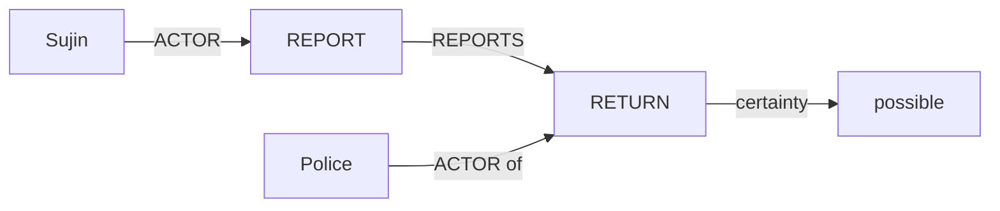

# DARI Claim Ledger와 Relational Micrograph 방법 v0.2

- 작성일: 2026-10-17
- 목적: [ARCHITECTURE.md](ARCHITECTURE.md)의 P1-P4를 구현하고 검증하기 위한 방법 정의

## 1. 연구 질문

핵심 질문은 “문장을 graph로 바꿀 수 있는가”가 아니다.

> DARI가 이미 가진 사용자 확인 claim과 evidence를 활용한 구조적 비교가, 비용을 맞춘 direct judge와 flat claim 방식보다 고위험 의미 변화를 더 잘 찾고 검수 부담을 줄이는가?

Graph가 도움이 되는 범위는 행위자와 대상, 정보 출처, 확실성의 적용 범위, 사건 순서처럼 **연결 구조가 중요한 오류**다. 누락, 숫자, 날짜, 명시적 부정은 먼저 단순하고 재현 가능한 규칙으로 검사한다.

## 2. 비교 단위: Semantic Claim

Graph의 node와 edge를 그대로 비교 API로 노출하지 않고, 검증 가능한 atomic claim을 1급 객체로 둔다.

```text
SemanticClaim
  claim_id
  event_id
  subject_id
  predicate
  object_id | normalized_value
  relation_type
  polarity
  certainty
  evidentiality
  scope_event_id
  evidence_spans[]
  assertion = explicit | inferred
  confidence
  origin = confirmed_fact | deterministic | model_extracted
```

예시는 다음과 같다.

```text
claim-1: ACTOR(search-1, police)
claim-2: TARGET(search-1, home)
claim-3: BEFORE(protest-1, search-1)
claim-4: certainty(return-1) = possible
claim-5: REPORTS(report-1, return-1)
claim-6: ACTOR(report-1, sujin)
```

이 claim들은 graph로 시각화할 수 있지만 comparator는 claim 단위로 보존·변경·미해결 상태를 계산한다.

## 3. Reference 구성

### 3.1 V2 기본 경로

V2에서는 confirmed `IntakeFact`를 결정론적으로 Claim Ledger로 투영한다.

| 제품 필드 | Claim Ledger 사용 |
| --- | --- |
| `id` | 안정적인 claim source ID |
| `requirementId` | predicate 또는 value family |
| `eventId` | 같은 사건의 claim 묶음 |
| `certainty` | claim certainty |
| `knowledge` | evidentiality |
| `sourceQuotes` | reference evidence |
| `supersedes` | correction lineage |
| `confirmed` | active reference 여부 |

구조화 필드로 알 수 없는 자유 서술의 participant relation만 제한적으로 모델로 추출한다. 이 결과는 confirmed fact와 구분해 confidence와 origin을 남긴다.

### 3.2 V1과 V3 확장

- V1: 원문 text extractor와 fact projector를 비교한다.
- V3: 확정된 한국어 artifact의 cached claims를 reference로 재사용하고 번역문만 새로 추출한다.

두 자유 텍스트를 매 실행마다 모두 재추출하는 symmetric full-graph 방식은 research ablation으로만 유지한다.

## 4. Semantic Contract

문항 또는 artifact 목적에 따라 검증 대상을 투영한다.

```text
required: 반드시 표현돼야 하는 claim
optional: 빠져도 오류가 아닌 claim
forbidden: superseded 또는 이 stage에 들어가면 안 되는 claim
allowed_transformations: 정상적인 요약, 호칭 변화, 문장 분할·병합
risk_weights: 오류 유형과 claim별 review 우선순위
```

Contract 없이 전체 Claim Ledger와 짧은 초안을 비교하면 정상적인 선택적 요약을 omission으로 오판한다.

## 5. Candidate 추출

Candidate Analyzer는 reference 내용을 보지 않는다.

1. 문단을 event window로 나눈다.
2. entity mention과 문서 내 coreference 후보를 만든다.
3. event와 atomic claim을 추출한다.
4. polarity, certainty, evidentiality를 정확한 claim 또는 relation에 붙인다.
5. 날짜, 수치, 횟수는 원문 표현과 normalized value를 함께 보존한다.
6. 모든 claim에 candidate evidence span을 붙인다.
7. 해석하지 못한 구간과 coverage를 기록한다.
8. 가능한 해석이 여러 개면 하나를 강제하지 않는다.

초안 문장의 `factIds`는 후보 검색 범위를 줄이는 anchor다. `factIds`가 맞다는 이유로 의미가 보존됐다고 판정하지 않는다.

## 6. 정렬

정렬은 싼 신호부터 사용한다.

1. 같은 fact ID, event ID, 가명 token 같은 hard anchor
2. event family와 순서 없는 participant 집합
3. 주변 claim과 문항 위치
4. 필요한 경우 multilingual embedding 후보 점수

```text
Alignment
  reference_claim_ids[]
  candidate_claim_ids[]
  cardinality
  method
  score
  margin_to_second_candidate
  excluded_feature
  alternatives[]
```

검출하려는 feature는 alignment score에서 제외한다.

- actor role 오류를 찾을 때 ACTOR와 TARGET label을 anchor로 쓰지 않는다.
- negation을 찾을 때 polarity를 쓰지 않는다.
- certainty 변화를 찾을 때 certainty를 쓰지 않는다.
- 날짜 변화를 찾을 때 날짜 동일성을 필수 조건으로 쓰지 않는다.

최고 후보와 차선 후보의 margin이 작으면 강제 정렬하지 않고 `unresolved`로 보낸다.

## 7. Relational Micrograph

Micrograph는 다음 관계만 초기 지원한다.

```text
ACTOR, TARGET, EXPERIENCER, RECIPIENT
REPORTS
BEFORE, AFTER, DURING
AT_TIME, AT_LOCATION, FREQUENCY
polarity, certainty, evidentiality
```

전체 AMR을 재현하려 하지 않는다. 오류 한 건을 판단하는 데 필요한 event와 인접 relation만 구성한다.



Candidate가 `possible`을 `certain`으로 바꾸면 event alignment는 유지한 채 qualifier 차이만 `certainty_shift`로 만든다.

## 8. Typed diff

| Condition | Finding |
| --- | --- |
| required claim에 대응 후보가 없음 | `omission` |
| 같은 event에서 participant role이 바뀜 | `actor_role_change` |
| 같은 claim의 polarity가 다름 | `negation_flip` |
| 같은 claim의 certainty가 다름 | `certainty_shift` |
| reporting source 또는 evidentiality가 다름 | `source_attribution_change` |
| entity, date, number, location value가 다름 | `identity_value_change` |
| 사건 순서, 기간, 빈도가 다름 | `temporal_change` |

판정 원칙은 다음과 같다.

- 한쪽 값이 unknown이면 오류를 강제하지 않는다.
- 낮은 extraction confidence 하나만으로 omission을 만들지 않는다.
- 같은 의미 변화에서 파생된 여러 claim diff는 finding 하나로 병합한다.
- 전체 similarity score로 개별 고위험 차이를 상쇄하지 않는다.
- 모든 finding은 양쪽 evidence와 claim ID를 가져야 한다.

## 9. 선택적 재확인

Targeted verifier는 기본 전제가 아니다. graph-only pilot에서 반복 오탐이 확인되고, 그 오탐을 국소 질문으로 줄일 수 있을 때만 추가한다.

재확인이 필요한 경우는 다음과 같다.

- alignment margin이 작음
- coreference 해석이 둘 이상임
- candidate coverage가 낮음
- deterministic path와 model path가 충돌함
- high-risk finding인데 evidence가 간접적임

동일 모델을 동일 prompt로 다시 호출하는 것은 독립 확인이 아니다. verifier를 쓰더라도 양쪽 원문에 각각 answerable한 질문을 만들고, `confirmed`, `rejected`, `abstained` 중 하나를 반환한다.

## 10. Baseline

Graph의 기술 가치는 다음 비교를 이길 때만 인정한다.

1. deterministic number/date/name/negation guard
2. flat claim plus bidirectional NLI
3. cost-matched direct LLM judge
4. COMETKiwi 또는 xCOMET가 적용 가능한 translation stage
5. symmetric full-graph extraction ablation

각 방법은 같은 taxonomy, evidence 계약, frozen split에서 평가한다. 최선 성능과 같은 모델 호출 비용 조건을 둘 다 보고한다.

## 11. Oracle 분해

```text
A0 Gold claim/graph + gold alignment + typed diff
A1 Predicted candidate claims + gold alignment
A2 Predicted claims + predicted alignment
A3 A2 + selective verifier
A4 Flat claims without relational edges
A5 Qualifier 제거
A6 Sentence-only context
A7 Symmetric full-graph extraction
A8 DARI fact anchor 제거
```

A0가 낮으면 schema와 comparator 문제다. A0는 높고 A1이 낮으면 extractor 문제다. A1은 높고 A2가 낮으면 aligner 문제다. A4와 차이가 없으면 graph 관계 구조를 제품 core에서 제거한다.

## 12. 연구와 DARI 설계의 연결

- [PropBank](https://aclanthology.org/J05-1004/)과 [MEANT](https://aclanthology.org/W13-2254/)에서 predicate-argument role 비교 아이디어를 가져왔다.
- [AMR](https://aclanthology.org/W13-2322/)과 [Smatch](https://aclanthology.org/P13-2131/)에서 node-edge meaning representation을 가져왔지만 full AMR은 사용하지 않는다.
- [S2MATCH](https://aclanthology.org/2020.tacl-1.34/)에서 soft semantic matching 아이디어를 가져오되 최종 오류 판정은 typed rule로 제한한다.
- [QuestEval](https://aclanthology.org/2021.emnlp-main.529/)의 QA 기반 정보 보존 아이디어를 선택적 재확인에만 쓴다.
- [xCOMET](https://aclanthology.org/2024.tacl-1.54/)은 error span을 제공하는 강한 baseline이다.
- [ACES와 SPAN-ACES](https://aclanthology.org/2025.cl-1.4/)는 평균 상관보다 현상별 challenge set과 source-sensitive 평가가 필요함을 보여준다.
- [Conformalizing Machine Translation Evaluation](https://aclanthology.org/2024.tacl-1.80/)의 문제의식을 따라 언어와 품질 그룹별 risk-coverage를 보정한다.

## 13. 현재 demo의 의미

현재 `graph_demo.py`는 hand-authored graph, `match_key` oracle, scripted confirmer를 사용한다. 따라서 증명된 것은 다음뿐이다.

- 주어진 graph를 계약대로 검증할 수 있음
- 일부 role, polarity, certainty, attribution, temporal diff가 동작함
- evidence와 finding을 report로 연결할 수 있음
- trace를 viewer에서 볼 수 있음

자동 claim extraction, 실제 alignment, natural error 성능, baseline 대비 우위는 아직 검증되지 않았다.
