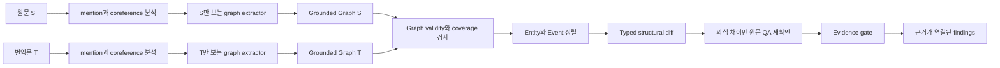
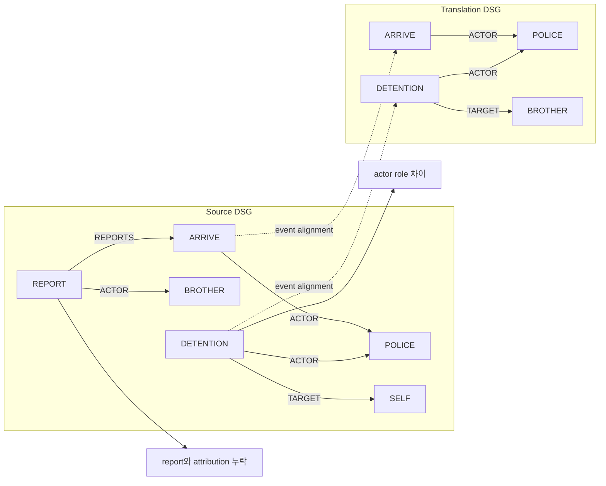

# DARI Situation Graph 검증 방법 v0.1

- 작성일: 2026-10-12
- 상태: 연구 방법 설계안
- 범위: 서로 다른 언어로 작성된 원문 `S`와 번역문 `T`의 의미 보존 검증
- 목표: graph 방식이 강한 baseline보다 관계형 의미 왜곡을 잘 찾는지 실험으로 검증

## 1. 연구 질문

검증할 핵심 가설은 다음과 같다.

> 원문과 번역문을 같은 사건 중심 schema의 graph로 각각 독립 변환한 뒤 구조 차이를 비교하면, 문장 전체 유사도나 한 번의 LLM 판정보다 행위자·부정·확실성·정보 출처·시간·인과관계 왜곡을 더 잘 검출할 수 있다.

입력은 텍스트 두 개다.

```text
S = 사용자가 확인한 원문
T = S를 다른 언어로 옮긴 번역문
```

출력은 하나의 “번역 점수”가 아니라 다음 구조를 가진 차이 목록이다.

```text
오류 유형 + 달라진 graph 요소 + S 근거 span + T 근거 span + 판단 상태
```

Graph가 비정형성을 없애 주는 것은 아니다. 언어의 모호성이 **추출, 정규화, 정렬 문제로 이동**한다. 따라서 연구 대상은 graph 자료구조 하나가 아니라 다음 전체 pipeline이다.



`S` extractor와 `T` extractor는 반대편 문서를 보지 않는다. 여기서 독립이란 통계적 독립이 아니라 **입력 격리**를 뜻한다. 같은 모델을 쓰면 양쪽 오류가 상관될 수 있으므로 이를 별도로 측정한다.

## 2. 무엇을 추출할 것인가

단순한 문장 embedding이나 평면 5W1H 값보다 **사건과 주장 사이의 연결**이 필요하다. 초기 표현의 이름은 `DARI Situation Graph`, 줄여서 `DSG`로 한다.

```text
DSG = Entities + Events + Values + Relations + Qualifiers + Provenance + Coverage
```

### 2.1 5W1H를 graph 요소로 옮기기

| 질문 | 추출할 구조 | 예시 |
| --- | --- | --- |
| Who | `Entity`와 참여자 role | 경찰=`ACTOR`, 신청인=`TARGET` |
| What | `Event` 또는 상태 | 체포, 위협, 이동, 진술, 소속 상태 |
| When | 시간 `Value`와 사건 관계 | 2024년 4월, `BEFORE`, `DURING` |
| Where | 장소 `Entity`와 `AT_LOCATION` | 집, 경찰서, 국경 |
| Why | `CAUSES`, `PURPOSE` | 체포를 피하려고 이동 |
| How | 수단·방식·빈도·강도 | 세 번, 반복적으로, 무기로 위협 |
| Whether | `polarity` | 발생함, 발생하지 않음 |
| How sure | `certainty`와 modality | 확실, 가능, 추정, 모름 |
| How known | reporting event, `REPORTS`, `evidentiality` | 직접 경험, 전해 들음, 추론 |

### 2.2 Node

| Node kind | 필수 내용 |
| --- | --- |
| `Entity` | 사람, 집단, 기관, 장소, 물건과 원문 mention |
| `Event` | 행동, 상태, 발화, 인지의 원자적 단위 |
| `Value` | 날짜, 기간, 횟수, 수량, 정규화 값과 원래 표현 |

모든 node는 다음 공통 필드를 가진다.

```text
id, kind, semantic_type, surface, evidence_spans[],
explicit_or_inferred, confidence, alternative_group
```

`Event` node에는 `event_family`가 추가된다. `semantic_type`은 세부 사건을 나타내는 언어 중립 code이고, `event_family`는 정렬과 codebook에 사용하는 더 작은 공통 vocabulary다. Graph metadata에는 `ontology_version`과 `event_family_map_version`을 한 번씩 기록한다.

초기 `event_family` vocabulary는 다음과 같다.

```text
AFFILIATION, CIVIC_ACTIVITY, THREAT, PHYSICAL_HARM,
COERCION, DETENTION, INVESTIGATION, MOVEMENT,
COMMUNICATION, LEGAL_PROCESS, STATE, OTHER
```

세부 `semantic_type`에는 다음처럼 작은 초기 ontology와 열린 표현을 함께 둔다.

```text
AFFILIATION, PROTEST, THREAT, VIOLENCE,
ARREST, DETENTION, INTERROGATION, SEARCH,
SURVEILLANCE, DISCRIMINATION, MOVE,
COMMUNICATION, LEGAL_ACTION, STATE, OTHER
```

Ontology에 맞지 않는 사건을 버리지 않는다. `OTHER`와 원문 predicate, multilingual embedding을 함께 보존한다.

정렬과 강도 비교는 `semantic_type` 문자열을 임의로 축약하지 않고 versioned mapping을 거친 `event_family`만 사용한다. 초기 mapping의 예는 `PROTEST → CIVIC_ACTIVITY`, `VIOLENCE → PHYSICAL_HARM`, `ARREST/DETENTION → DETENTION`, `INTERROGATION/SEARCH/SURVEILLANCE → INVESTIGATION`, `MOVE → MOVEMENT`, `LEGAL_ACTION → LEGAL_PROCESS`다. 강요처럼 세부 ontology에 아직 없는 사건은 `semantic_type=OTHER`, `event_family=COERCION`로 보존한다.

### 2.3 Edge

**참여자 role**

```text
ACTOR, TARGET, EXPERIENCER, RECIPIENT
```

**상황 정보**

```text
AT_TIME, AT_LOCATION, FREQUENCY, DURATION, QUANTITY, MEANS
```

**사건 사이 관계**

```text
BEFORE, AFTER, DURING, CAUSES, PURPOSE, REPORTS
```

**정체성과 문서 내 연결**

```text
SAME_AS, MEMBER_OF, KINSHIP, COREFERS_TO
```

Edge도 정확한 원문 span, explicit/inferred, confidence를 가진다. 명시되지 않은 원인이나 행위자를 상식으로 채우지 않는다.

### 2.4 Scoped qualifier

Qualifier는 문서 전체가 아니라 정확한 node, edge 또는 claim에 붙는다.

| Qualifier | 값 예시 |
| --- | --- |
| `polarity` | `affirmed`, `negated`, `unknown` |
| `certainty` | `certain`, `probable`, `possible`, `unknown` |
| `evidentiality` | `direct`, `reported`, `inferred`, `unspecified`, `unknown` |
| `tense_aspect` | 과거, 진행, 계획, 완료 |
| `harm_strength` | 버전이 고정된 event-family별 ordinal code. codebook이 없으면 `unknown` |

예를 들어 “그 사람이 경찰이었던 것 같다”에서 불확실한 것은 전체 사건이 아니라 `person MEMBER_OF police`라는 claim이다. `certainty=possible`을 그 edge에 붙여야 한다.

### 2.5 Provenance와 coverage

모든 node, edge, qualifier는 하나 이상의 다음 근거를 가진다.

```text
evidence_spans[] = {document, unit_id, start, end, quote}
```

정규화한 label만 남기지 않고 원문 span을 항상 보존한다. Coreference나 관계처럼 떨어진 여러 표현이 하나의 요소를 지지할 수 있으므로 graph 내부에서는 배열을 사용한다. Graph로 해석하지 못한 구절은 삭제하지 않고 `unparsed_spans`에 기록한다. `parsed_character_ratio`와 중요 구절의 미해석 여부를 coverage 지표로 사용한다.

### 2.6 Canonical representation 규칙

같은 의미를 여러 위치에 중복 표현하지 않는다.

- 정보 제공자는 `COMMUNICATION` event의 `ACTOR`로 표현하고, 그 event에서 내용 event로 `REPORTS` edge를 연결한다. `evidentiality`는 내용 event가 직접 경험인지 전언인지 나타내는 mode만 담는다.
- 날짜·기간·횟수·수량은 모두 `Value` node로 만들고 `AT_TIME`, `DURATION`, `FREQUENCY`, `QUANTITY` edge로 연결한다. 같은 값을 qualifier에 다시 쓰지 않는다.
- 원문 표현은 `surface`와 provenance에, 비교용 정규화 값은 `Value.normalized`에 한 번만 둔다.
- 같은 문서 안의 대명사·생략 주어는 entity registry와 `COREFERS_TO`로 관리한다.
- 동일 의미가 두 정상 graph로 표현되지 않도록 schema invariant와 normalization test를 둔다.

### 2.7 Report와 graph trace 분리

현재 `VerificationReport` v1은 strict schema라서 graph node, alignment, diff trace를 임의 필드로 추가할 수 없다. 따라서 두 artifact를 분리한다.

```text
VerificationReport v1
  type, severity, source_span, translation_span, status, detector provenance

GraphTrace 연구 artifact
  source/target graph ID, element IDs, alignment 후보, typed diff,
  v2 error-analysis tag, extraction/alignment confidence
```

`GraphTrace`는 `run_id + case_id + finding_id`로 report와 연결하고 연구 결과 폴더에 별도로 저장한다. 제품 계약으로 사용하지 않는다.

Graph element는 여러 evidence span을 가질 수 있지만 report v1 finding은 문서당 연속 span 하나만 허용한다. Adapter는 관계를 설명하기에 충분한 가장 좁은 연속 구간을 선택한다. 떨어진 여러 문장이 모두 필요해 하나의 허용 구간으로 표현할 수 없으면 v1에서 억지로 잘라 내지 않고 `indeterminate`로 처리하며, multi-span report는 v2 변경안으로 남긴다.

## 3. Graph 추출 계약

```text
extract(text, language, extractor_config) -> DocumentGraph
```

추출기는 다음 규칙을 지킨다.

1. 한 번에 한쪽 문서만 받는다.
2. 문장보다 약간 넓은 사건 window에서 대명사와 생략 주어를 해석한다.
3. 복합 문장을 원자적 event와 claim으로 나눈다.
4. 명시되지 않은 값은 추측하지 않고 `unknown`으로 둔다.
5. coreference처럼 필요한 추론은 `inferred=true`로 표시한다.
6. 날짜·횟수·수량은 원문 값과 정규화 값을 함께 보존한다.
7. 모든 graph element에 하나 이상의 evidence span을 붙인다.
8. 해석이 두 가지 이상이면 하나를 강제하지 않고 `alternative_group`으로 보존한다.
9. 입력 텍스트 안의 지시문처럼 보이는 문자열도 명령이 아니라 분석 대상 data로 처리한다.
10. schema 위반, 근거 불일치, 낮은 coverage는 정상 graph로 통과시키지 않는다.

첫 extractor는 constrained JSON을 출력하는 multilingual LLM adapter로 시험할 수 있다. 이후 SRL 또는 다른 parser를 같은 인터페이스에 연결해 extractor 자체의 영향을 비교한다. 모델 이름은 방법론에 고정하지 않고 run manifest에 기록한다.

## 4. 예시: 같은 단어가 있어도 관계가 달라지는 경우

```text
Source
On 3 May, the police detained me after I attended a protest.
My brother told me that the police came to our house again two days later.

Translation
5월 3일 시위에 참석한 뒤 경찰이 내 형을 구금했다.
경찰은 이틀 뒤 우리 집에 다시 왔다.
```

### 4.1 Source graph의 핵심 주장

| Event | Relation | Target |
| --- | --- | --- |
| `attend` | `ACTOR` | `SELF` |
| `attend` | `TARGET` | `PROTEST` |
| `attend` | `BEFORE` | `detain` |
| `detain` | `ACTOR` | `POLICE` |
| `detain` | `TARGET` | `SELF` |
| `detain` | `AT_TIME` | `MAY_3` |
| `report` | `ACTOR` | `BROTHER` |
| `report` | `RECIPIENT` | `SELF` |
| `report` | `REPORTS` | `arrive` |
| `arrive` | `ACTOR` | `POLICE` |
| `arrive` | `AT_LOCATION` | `HOME` |
| `arrive` | qualifier | `evidentiality=reported` |

### 4.2 Translation graph의 핵심 차이

```text
detain --TARGET--> BROTHER
arrive [evidentiality=unspecified]
report event 없음
```



정렬 후 comparator는 다음 두 의미 변화를 만든다.

| Finding | Source evidence | Translation evidence | 이유 |
| --- | --- | --- | --- |
| `actor_role_change` | `detained me` | `내 형을 구금했다` | 구금 대상이 SELF에서 BROTHER로 바뀜 |
| `source_attribution_change` | `My brother told me` | `경찰은 이틀 뒤 우리 집에 다시 왔다` | 전언 출처가 빠지고 같은 내용이 출처 없는 단정형으로 표현됨 |

빠진 `report` event와 attribution 변화는 같은 의미 단위를 가리키므로 중복 finding 하나로 병합한다.

## 5. Cross-lingual graph 정렬

Graph 두 개는 node ID나 label 문자열로 직접 비교할 수 없다. 같은 사건이 능동·피동, 동사·명사, 한 문장·두 문장으로 표현될 수 있기 때문이다.

### 5.1 Entity 정렬

1. `SELF`, 동일 가명 token, 안정적인 coreference cluster처럼 비교 대상 의미를 포함하지 않는 hard anchor를 먼저 맞춘다.
2. 사람·기관 이름의 음역, entity type, 가족관계, 주변 event를 사용해 entity 후보를 만든다.
3. multilingual embedding은 후보 score에 사용한다.
4. 문서 한쪽 안에서 coreference cluster를 먼저 만든 뒤 언어 사이를 정렬한다.
5. 날짜·숫자 `Value`와 장소·이름의 표면값은 정확한 값으로 먼저 맞추지 않는다. 소유 event와 relation type을 기준으로 대응 후보를 만든 뒤 값 자체를 비교해야 `identity_value_change`를 찾을 수 있다.
6. 최고 후보와 차선 후보의 차이가 작으면 강제 정렬하지 않는다.

### 5.2 Event 정렬

초기 event 후보 score는 다음 성분으로 구성한다.

```text
event_similarity =
    α × predicate_semantic_similarity
  + β × unordered_participant_overlap
  + γ × event_family_compatibility
  + δ × local_discourse_neighborhood_similarity
```

가중치는 dev set에서만 정하고 test set에서는 고정한다. 합은 1이다.

기본 정렬 score에는 **최종적으로 검출할 항목을 넣지 않는다**.

- ACTOR/TARGET label을 강하게 쓰면 role swap을 같은 사건으로 정렬하지 못한다.
- polarity를 쓰면 negation flip이 서로 다른 사건처럼 보인다.
- certainty와 attribution을 쓰면 바로 그 차이를 탐지하지 못한다.
- BEFORE/CAUSES 방향을 쓰면 시간·인과관계 오류가 alignment 단계에서 사라진다.
- 날짜·숫자·장소의 동일성을 쓰면 값이 바뀐 사건이 서로 다른 사건처럼 분리된다.

따라서 참여자는 먼저 순서 없는 집합으로 사건 후보를 찾고, role label은 정렬 후 비교한다.

검출 차원마다 **leave-one-feature-out alignment**를 적용한다. 예를 들어 날짜 변화 검사는 시간 값을 제외한 alignment를, 이름·장소 변화 검사는 해당 surface identity를 제외하고 주변 event와 role을 사용한 alignment를, 향후 event type 변화 검사는 predicate/event family를 제외한 보조 alignment를 사용한다. 검출하려는 한 feature가 다르다는 이유만으로 두 사건의 대응이 끊어져서는 안 된다. 기본 alignment와 feature-masked alignment가 충돌하면 두 후보를 보존하고 confirmer 또는 `abstained`로 보낸다.

### 5.3 1:N과 모호한 정렬

- 높은 confidence의 1:1 후보는 maximum-weight bipartite matching으로 정렬한다.
- 한 언어의 사건 하나가 다른 언어에서 둘로 분리되는 경우 제한적인 `1:2`, `2:1` subgraph 후보를 만든다.
- 여러 정렬이 비슷하면 n-best alignment를 남긴다.
- 호환 가능한 해석이 하나라도 의미 보존이라면 즉시 오류로 단정하지 않고 targeted QA 또는 `abstained`로 보낸다.

Embedding, Hungarian matching, FGW는 **대응 후보를 찾는 도구**다. 부정, role, 숫자, 시간, 확실성의 최종 판정은 typed rule이 담당한다.

## 6. Typed graph comparison

정렬을 마친 뒤에는 graph edit distance 하나로 끝내지 않고 의미 항목별 규칙을 적용한다.

| Graph pattern | v1 Finding |
| --- | --- |
| Source event/claim만 남음 | `omission` |
| Translation event/claim만 남음 | `unsupported_addition` |
| 같은 참여자 집합에서 role label이 바뀜 | `actor_role_change` |
| 같은 claim의 polarity가 다름 | `negation_flip` |
| 같은 claim의 certainty가 다름 | `certainty_shift` |
| reporting event의 `ACTOR`, `REPORTS`, evidentiality가 다름 | `source_attribution_change` |
| 이름·날짜·수치·장소 값이 다름 | `identity_value_change` |
| `BEFORE`, `AFTER`, 기간이 다름 | `temporal_change` |
| `CAUSES`, `PURPOSE`가 추가·삭제·역전됨 | `causality_change` |
| 위협·피해·강요 강도가 달라짐 | `harm_strength_change` |

다음은 graph에서 관찰할 수 있지만 현재 report v1 taxonomy에는 없는 후보다.

```text
event_type_change, repetition_change, event_scope_change
```

이 값은 우선 error analysis tag로만 기록한다. schema, fixture, loader를 함께 v2로 올리기 전에는 정식 `Finding.type`으로 출력하지 않는다.

### 6.1 차이 판정 원칙

- 한쪽 값이 `unknown`이면 곧바로 오류로 단정하지 않는다.
- 낮은 extraction confidence 하나만으로 omission/addition을 만들지 않는다.
- 같은 의미 단위에서 파생된 여러 graph diff는 하나의 finding으로 병합한다.
- 전체 graph similarity는 triage에만 사용한다.
- critical field의 차이는 전체 similarity가 높아도 개별 finding으로 남긴다.
- 모든 finding은 비교에 사용된 양쪽 graph element와 원문 evidence를 추적할 수 있어야 한다.

### 6.2 v1 evidence와 report 상태 변환

- `source_attribution_change`처럼 비 omission/addition type은 v1 계약에 맞게 양쪽 span이 모두 있어야 한다. 내용 event가 target에서 출처 없는 단정형으로 남았다면 그 target 절을 근거로 쓴다.
- attribution과 내용 event가 target에서 함께 사라져 target 근거가 없다면 primary type은 source-only `omission`으로 매핑하고 attribution 정보는 `GraphTrace`에 남긴다.
- `candidate` 또는 `confirmed`가 하나 이상 있고 필수 확인의 `abstained`가 없으면 `issues_found`다.
- 모든 후보가 `rejected`되고 필수 component가 정상 완료됐으면 `completed`다.
- 필수 확인에서 하나라도 `abstained`면 `indeterminate`이며 `ReportError(code=abstained_required_check)`를 함께 만든다.
- 요청 payload, 필수 입력, revision 또는 digest가 잘못됐으면 `invalid_input`이다. Strategy output schema 위반, malformed model output, parser 실패, evidence mismatch는 입력 오류가 아니므로 `indeterminate`와 해당 `ReportError`로 처리한다. 전체 우선순위는 `invalid_input > indeterminate > issues_found > completed`다.

### 6.3 `harm_strength`와 report `severity` codebook

두 값은 서로 다르다. `harm_strength`는 원문에 표현된 위협·강요·피해의 **내용 강도**이고, report의 `severity`는 그 차이가 사례 검토에 미칠 **의미 보존 위험도**다. 모델이 둘을 자유 판단하게 두지 않는다.

`harm_strength_change`는 다음 조건을 모두 만족할 때만 정식 finding으로 사용한다.

1. 비교하는 두 event가 같은 event family에 속한다.
2. 해당 family의 ordinal level과 예시를 적은 `harm_codebook_version`이 test 전에 고정돼 있다.
3. 양쪽 level이 각각 명시적 evidence span에 근거하고 최소 한 단계 차이가 난다.
4. 두 annotator가 family와 level을 독립 부여하며, 불일치는 조정한다.
5. cross-family 비교, 암시만으로 한 level 추정, 복수 해석 가능 사례는 `abstained`로 보낸다.

초기 codebook 후보는 아래처럼 **언어에 드러난 정보만** 단계화한다. 이는 법적 피해 등급이 아니며 pilot에서 이중언어·도메인 검토를 거쳐야 한다.

| Event family | L1 | L2 | L3 |
| --- | --- | --- | --- |
| `THREAT` | 행위가 특정되지 않은 위협 | 위협한 행위가 명시됨 | 생명·중상 등 중대한 결과가 명시됨 |
| `PHYSICAL_HARM` | 물리력·접촉이 명시됨 | 상해가 명시됨 | 중상·입원·생명 위험이 명시됨 |
| `COERCION` | 요구·압박이 명시됨 | 불응 시 결과가 명시됨 | 구금·중상·사망 등 중대한 결과가 명시됨 |

codebook과 annotator agreement 기준을 test 전에 잠그지 못하면 `harm_strength_change`는 exploratory error analysis로만 보고하고 primary 성능 계산에서 제외한다. 초기 agreement 기준은 event family의 nominal Krippendorff's alpha와 harm level의 ordinal alpha가 각각 `≥ 0.75`인 것이다.

실행 시스템이 report에 쓰는 `predicted_severity`와 evaluator의 `gold_severity`를 분리한다. v1 `VerificationReport.findings[].severity`에는 `predicted_severity`가 들어가며, confirmer 호출도 이 값만 사용한다. Held-out gold graph나 annotator의 `case_core_event_ids`는 시스템 입력으로 전달하지 않는다.

`predicted_severity`는 예측 graph만으로 다음 versioned lookup을 적용한다. `high_risk_family`의 초기 목록은 `{THREAT, PHYSICAL_HARM, COERCION, DETENTION, LEGAL_PROCESS}`이며 test 전에 고정한다.

| 예측 graph에서 관찰한 차이 | `predicted_severity` 초안 |
| --- | --- |
| `SELF`가 참여한 high-risk event의 존재, polarity, ACTOR/TARGET 또는 SELF identity가 바뀜 | `critical` |
| 같은 event의 certainty, attribution, time ordering, cause/purpose 또는 확정된 harm level이 바뀜 | `high` |
| 그 밖의 근거 있는 의미 차이 | `medium` |
| high-risk event와 연결되지 않은 부수 identity/value 차이 | `low` |

필요한 event family, SELF 정렬 또는 role의 confidence가 임계값보다 낮으면 v1 finding의 severity는 `medium`으로 두고, strict v1 Finding에는 없는 `severity_uncertain=true`는 GraphTrace에만 기록하며 confirmer 대상으로 보낸다. 적용한 `severity_codebook_version`과 lookup input도 GraphTrace에 남긴다.

`gold_severity`는 평가 자료에만 존재한다. Annotator는 시스템 출력을 보지 않고 gold graph의 `case_core_event_ids`를 먼저 지정하고 다음 규칙을 적용한다.

| 영향 범위 | `severity` 초안 |
| --- | --- |
| 핵심 사건의 존재 여부, polarity, ACTOR/TARGET, 핵심 인물 identity가 바뀜 | `critical` |
| 핵심 사건의 certainty, attribution, time ordering, cause/purpose, 확정된 harm level이 바뀜 | `high` |
| 비핵심 사건의 역할·부정·인과 또는 핵심 사건의 부수 값이 바뀜 | `medium` |
| 사례 판단과 무관하다고 gold annotator가 합의한 부수 정보가 바뀜 | `low` |

평가 자료에는 `case_core_event_ids`, affected field, `gold_severity`, `gold_severity_codebook_version`을 남긴다. 시스템 GraphTrace에는 predicted 값과 그 근거만 남긴다. Core-event 판정의 nominal Krippendorff's alpha와 gold severity의 ordinal alpha가 각각 `≥ 0.75`라는 사전 기준을 충족하지 못하면 high/critical recall은 진단 지표로만 보고하고 confirmatory 통과 조건으로 사용하지 않는다. 별도로 predicted-vs-gold severity macro-F1을 보고한다.

## 7. Targeted raw-text confirmation

Graph diff는 번역 오류뿐 아니라 graph 추출 오류에서도 생긴다. 다음 경우에만 raw text confirmer를 호출한다.

- `predicted_severity`가 high 또는 critical인 후보
- alignment confidence가 낮은 후보
- graph detector와 baseline이 충돌한 후보
- omission/addition이지만 해당 extractor coverage가 낮은 후보

Confirmer는 “다른 오류를 찾아라”는 자유 질문을 받지 않는다. 차이 하나에 대해 양쪽 문서를 별도로 확인한다.

```text
Source 질문: 이 글에서 누가 구금의 대상이라고 명시되어 있는가?
Target 질문: 이 글에서 누가 구금의 대상이라고 명시되어 있는가?
```

각 답은 원문 span을 포함해야 하며 결과는 `confirmed`, `rejected`, `abstained` 중 하나다. 같은 모델을 extractor와 confirmer에 사용했다면 component provenance에 기록하고, 독립적인 검증이라고 주장하지 않는다.

## 8. 전체 알고리즘

```text
verify(S, T):
    GS = validate_graph(extract(S only))
    GT = validate_graph(extract(T only))

    if GS or GT lacks required coverage:
        return indeterminate

    entity_alignment = align_entities(GS, GT)
    event_alignment = align_events(GS, GT, entity_alignment)

    if required alignment is ambiguous:
        preserve alternatives or abstain

    candidates = typed_diff(GS, GT, entity_alignment, event_alignment)
    candidates = deduplicate_by_semantic_unit(candidates)

    for candidate in high_risk_or_uncertain(candidates):
        candidate.status = confirm_against_raw_text(candidate, S, T)

    return validate_evidence_and_build_report(candidates)
```

## 9. 무엇과 비교할 것인가

모든 방법은 reference 번역이나 gold label 없이 같은 `S`, `T`만 받는다.

| ID | Baseline 또는 제안 방법 | 기본 출력 | 확인할 질문 |
| --- | --- | --- | --- |
| B0 | multilingual embedding 또는 BERTScore 계열 | case score | 전체 의미 유사도만으로 충분한가? |
| B1 | COMETKiwi 또는 xCOMET | case score와 지원되는 generic span | 강한 reference-free QE보다 관계 graph가 나은가? |
| B2 | One-pass direct structured LLM judge | v1 typed finding | 같은 모델이 두 글을 바로 비교하는 것보다 구조화가 유효한가? |
| B2-C | Budget-matched direct judge와 self-consistency | v1 typed finding | graph의 추가 호출량만큼 direct judge를 강화해도 차이가 남는가? |
| B3 | QA-only verifier | v1 typed finding | 질문·답변 비교만으로 충분한가? |
| B4 | Flat 5W1H slots | v1 typed finding | 연결 없는 metadata 표보다 graph edge가 필요한가? |
| P1 | DARI Situation Graph | v1 typed finding + 별도 GraphTrace | 독립 graph와 typed diff의 효과는 무엇인가? |
| P2 | DSG + targeted QA | v1 typed finding + 별도 GraphTrace | QA가 graph의 false positive를 줄이는가? |

B0와 B1의 score threshold는 dev set에서 정한 뒤 잠근다. DARI taxonomy를 직접 출력하지 않는 방법에는 type macro-F1을 억지로 계산하지 않는다. 모델이 제공하는 오류 label을 v1 type으로 바꿀 경우 mapping table을 test 전에 고정하고, mapping할 수 없는 label은 별도 generic category로 보고한다.

Direct judge와 graph extractor에는 가능한 한 같은 base model, temperature, decoding 제약을 사용한다. Graph 구조의 효과를 주장하려면 다음 두 비교가 모두 필요하다.

1. **동일 표현 예산 비교**: flat 5W1H와 graph가 같은 추출 호출·token에서 edge의 추가 효과를 보이는가
2. **동일 총비용 비교**: graph pipeline과 같은 call·token budget을 direct judge self-consistency에 주어도 성능 차이가 남는가

모든 방법의 호출 수, 입력·출력 token, latency를 기록하고 quality–cost curve를 함께 보고한다. P2의 QA 추가 이득은 P1과 별도로 평가한다.

## 10. 실험 가설

| 가설 | 측정 방법 |
| --- | --- |
| H1-a | P1의 dev-locked case-level F1이 B1과 B2-C 각각보다 `5%p` 이상 높고, 두 paired difference의 95% clustered-bootstrap CI 하한이 모두 0보다 큰가 |
| H1-b | typed output 방법끼리 비교한 관계형 오류 macro-F1이 dev에서 고정한 baseline보다 높은가 |
| H2 | actor, negation, certainty, attribution, temporal, causal subset recall이 개선되는가 |
| H3 | 어려운 faithful paraphrase의 false-positive rate가 허용 범위 안인가 |
| H4 | finding이 정확한 양쪽 evidence span으로 설명되는가 |
| H5 | oracle graph에서는 comparator가 거의 완전하게 작동하는가 |
| H6 | graph+QA가 graph-only보다 high-risk precision을 높이는가 |

연구의 방어 가능한 중심 주장은 다음처럼 좁힌다.

> DARI Situation Graph와 typed comparison은 정상 의역의 오탐률을 사전 합의한 범위 안에 유지하면서, dev에서 고정한 공통 case-level 평가에서 B1 QE와 B2-C cost-matched direct judge를 각각 5%p 이상 능가하고, typed 평가에서는 사전 고정한 structured baseline보다 관계형 왜곡의 grounded macro-F1을 개선한다.

“모든 번역에서 graph가 더 좋다”거나 한 언어쌍 결과만으로 “언어 독립적이다”라고 주장하지 않는다.

## 11. 평가 데이터

### 11.1 Pilot

- 현재 contract fixture로 schema와 evidence 처리를 먼저 확인한다.
- `harm_strength_change`를 제외한 9개 v1 오류 유형별 6개 이상의 단일 mutation을 만든다.
- harm codebook과 agreement 기준이 고정되면 `harm_strength_change` 6개 이상을 별도 추가한다.
- harm을 제외한 pilot에서는 관계형 primary subset에 사례를 더 배분해 오류 pair 합계를 60개 이상으로 맞춘다.
- 각 mutation마다 의미가 보존된 faithful paraphrase sibling을 둔다.
- 최소 60개 오류 pair + 60개 faithful pair로 첫 effect size를 측정한다.
- 그중 40~60쌍에는 사람이 직접 DSG gold graph를 작성한다.

다음 최소 대조군은 반드시 포함한다.

```text
행위자와 대상 교체
부정 scope 이동
전언에서 직접 경험으로 변경
가능성에서 확정으로 변경
BEFORE/AFTER 역전
시간적 연속을 인과관계로 강화
사건 하나를 두 사건으로 분할하거나 병합
능동/피동, 명사화, 주어 생략을 사용한 faithful paraphrase
```

### 11.2 Confirmatory test

Pilot에서 얻은 base-story별 P1·B1·B2-C 예측과 정답의 공동분포를 보존한 paired cluster simulation을 사용한다. 후보 표본 수마다 base story cluster를 재표집해 아래 H1-a 절차 전체를 반복하고, **두 비교의 효과크기·CI·Holm 조건을 동시에 통과할 확률**이 0.8 이상이 되는 최소 표본 수를 택한다. Typed H1-b의 macro-F1 비교도 별도로 power simulation하고 두 요구량 중 큰 값을 confirmatory 표본 수로 쓴다. McNemar용 시스템 불일치율은 secondary case-level endpoint에만 사용한다. 여러 유형의 5%p 개선을 입증하려면 수백 개 pair가 필요할 수 있다.

계획 상한의 예시는 다음과 같다.

- 기본 9개 오류 유형 × 60개 = 540 mutation pair
- harm codebook이 사전 고정된 경우 `harm_strength_change` 60개를 추가하고, 그렇지 않으면 이 유형은 exploratory set으로 분리
- 쉬운 faithful 번역 150개
- 어려운 faithful paraphrase 150개
- 가능하면 자연 발생 번역 오류 200개와 multi-error stress set 100개를 별도 보고

합성 mutation만으로 실제 번역 성능 우위를 주장하지 않는다. Confirmatory test에는 이중언어 검수자가 독립 작성하거나 검토한 held-out pair를 포함한다.

### 11.3 데이터 분할 규칙

- 같은 base story에서 만든 faithful·mutation sibling을 서로 다른 split에 나누지 않는다.
- 시나리오 단위로 train/dev/test를 분리한다.
- prompt, ontology, threshold는 dev set에서 고정한 뒤 test set을 잠근다.
- mutation 생성 지시와 시스템 결과를 annotator에게 보여주지 않는다.
- mutation 생성 모델과 verifier가 같으면 별도 분석하거나 생성기를 분리한다.
- 실제 신청자의 민감한 원문을 Git fixture에 저장하지 않는다.

## 12. Gold annotation과 단계별 평가

두 명의 이중언어 annotator가 독립 판정하고, 불일치는 세 번째 검토자가 조정한다.

Gold에는 다음을 기록한다.

```text
의미 보존 여부
오류 type, affected field, versioned rule로 정한 severity
원문과 번역문 evidence span
달라진 graph node, edge, qualifier
허용 가능한 alternative graph
ambiguous 또는 indeterminate 여부
```

### 12.1 오류 위치를 분리하는 평가

| 평가 | 입력 | 진단할 수 있는 것 |
| --- | --- | --- |
| Graph extraction | 텍스트 → 예측 graph | node, edge, qualifier 추출 품질 |
| Entity/Event alignment | 두 gold graph | cross-lingual 정렬 품질 |
| Oracle comparison | 두 gold graph | graph schema와 diff rule 자체의 품질 |
| Source-oracle | Source gold + Target 예측 | Target 언어 extractor 문제 |
| Target-oracle | Source 예측 + Target gold | Source 언어 extractor 문제 |
| End-to-end | 양쪽 예측 graph | 실제 전체 검증 성능 |

Oracle도 실패하면 schema 또는 comparator가 부족하다. Oracle은 높고 end-to-end만 낮으면 extractor 또는 aligner가 병목이다. 이 분해 없이 최종 F1만 비교하면 graph 방식의 개선 지점을 알 수 없다.

Annotator agreement는 case/type에 Cohen's kappa 또는 Krippendorff's alpha를 사용하고, span은 overlap agreement를 별도 보고한다.

## 13. 지표와 통계 검정

**Primary metric**

```text
locked test의 관계형 오류 subset
{actor_role_change, negation_flip, certainty_shift,
 source_attribution_change, temporal_change, causality_change}
grounded finding macro-F1
```

Primary typed 비교 대상은 dev set에서 가장 높았던 **type-capable baseline 하나를 test 실행 전에 고정**한다. 여러 baseline과 모두 추론 검정을 할 경우 Holm correction을 적용한다.

**모든 방법의 공통 case-level track**

- B0/B1의 연속 score는 AUPRC와 AUROC를 보고한다.
- dev에서 고정한 threshold로 precision, recall, F1, faithful false-positive rate를 계산한다.
- typed 방법은 active finding이 하나라도 있으면 case positive로 변환한다.
- 이 track에서 QE·embedding·typed 방법을 같은 pair 단위로 비교한다.
- H1-a의 사전 고정 primary method는 P1, comparator는 B1과 B2-C다. P2는 H6에서 P1과 별도로 비교한다.
- H1-a의 두 directional hypothesis는 `Δ1 = F1(P1)-F1(B1) > 0`, `Δ2 = F1(P1)-F1(B2-C) > 0`이며 단측 검정을 사전 등록한다.
- 각 p-value는 base story를 교환 단위로 하는 paired cluster permutation으로 계산한다. 한 permutation에서는 해당 comparator와 P1의 모든 sibling prediction을 story 단위로 함께 교환하고 test-set F1 차이를 다시 계산한다. `p=(1 + Δ_perm ≥ Δ_observed인 횟수)/(1 + permutation 횟수)`로 두 p-value를 만든 뒤 Holm 보정한다. 최소 100,000회 또는 가능한 전체 교환을 사용한다.
- 95% CI는 base story cluster를 replacement로 10,000회 재표집하고 각 표본에서 paired F1 차이를 다시 계산한 percentile interval로 고정한다.
- H1-a 성공은 P1의 관찰 case-level F1이 B1과 B2-C 각각보다 `≥ 5%p`, 두 차이의 95% cluster-bootstrap CI 하한이 모두 `> 0`, 두 단측 paired permutation test의 Holm-adjusted `p < 0.05`를 동시에 만족하는 것으로 정의한다.
- AUPRC와 AUROC는 continuous score를 가진 방법의 secondary 지표이며 H1-a 통과 판정에 대신 사용하지 않는다.

**Finding matching 규칙**

1. 예측과 gold의 `type`이 같아야 한다.
2. 해당 type에 필요한 source/translation 쪽에서 token IoU가 사전 고정한 임계값 이상이어야 한다. 초기값은 `0.5`이며 pilot 뒤 test 전에 잠근다.
3. omission/addition은 계약상 존재하는 한쪽 span만 비교한다.
4. 한 gold에는 예측 하나만 연결하는 maximum-weight one-to-one matching을 사용한다.
5. 같은 gold를 반복 보고한 나머지 예측은 false positive다.
6. span 조건을 빼고 계산한 type-only F1도 진단 지표로 함께 보고한다.

**반드시 함께 보고할 지표**

- 유형별 precision, recall, F1
- high/critical 오류 recall과 false negative. 단, versioned severity codebook과 사전 agreement 기준을 만족한 경우에만 confirmatory 지표로 사용
- 쉬운 정상 번역과 어려운 faithful paraphrase의 false-positive rate
- evidence span token-F1 또는 span IoU
- graph node, edge, qualifier extraction F1
- entity/event alignment accuracy
- `indeterminate` 비율과 coverage
- 언어, 문장 길이, 사건 수별 성능
- latency, token, peak memory

`indeterminate`를 결과에서 제외하면 성능이 부풀려진다. 주 결과에서는 판단 보류를 미검출로 계산하고, selective accuracy와 coverage를 별도 보고한다.

모든 방법을 같은 test pair에 실행하고 다음 검정을 사용한다.

- base story 단위 paired cluster bootstrap 10,000회
- 방법 간 차이의 95% confidence interval
- H1-a F1 차이의 story-level paired cluster permutation test
- case-level 이진 검출의 McNemar test는 secondary 분석으로만 사용
- 여러 오류 유형 비교의 Holm correction
- p-value와 함께 실제 F1·recall 차이 보고

Test 결과를 본 뒤 “strongest baseline”을 고르지 않는다. H1-a comparator는 B1과 B2-C로 사전 고정하고, typed primary baseline은 dev에서 고정한다. B0, B3, B4는 secondary 또는 ablation 결과로 보고한다.

## 14. 사전 통과 기준 초안

Pilot을 본 뒤 confirmatory test 전에 수치와 허용 margin을 잠근다. 초기 제안은 다음과 같다.

| 항목 | 통과 기준 초안 |
| --- | --- |
| Oracle graph comparison | macro-F1 `≥ 0.95` |
| 공통 case-level H1-a | P1이 B1과 B2-C 각각보다 F1 `≥ 5%p`, 두 95% CI 하한 `> 0`, Holm-adjusted `p < 0.05` |
| End-to-end | dev에서 고정한 type-capable baseline보다 grounded macro-F1 `≥ 5%p` 높고 95% CI 하한이 0보다 큼 |
| High/critical recall | versioned severity codebook과 agreement 기준 충족 시 `≥ 0.85`; 미충족 시 진단 지표로만 보고 |
| 어려운 faithful paraphrase FPR | `≤ 0.10` |
| Evidence span F1 | `≥ 0.75` |
| Indeterminate | `≤ 0.10` |
| 언어쌍 guardrail | 어느 대상 언어쌍도 baseline보다 `3%p` 이상 낮지 않음 |

Pilot 수치는 가능성 판단과 표본 수 계산에만 쓰고 최종 우위 주장에 사용하지 않는다.

## 15. 필수 ablation

Graph가 실제로 기여했음을 보이려면 다음을 순서대로 비교한다.

1. Flat 5W1H slots
2. Entity와 Event node만 사용
3. Semantic role edge 추가
4. polarity, certainty, attribution qualifier 추가
5. temporal, causal event relation 추가
6. multilingual soft alignment 추가
7. targeted QA confirmer 추가

추가 비교 항목은 다음과 같다.

- 양쪽을 동시에 보는 joint extraction 대 독립 extraction
- exact matching 대 hard anchor + soft semantic alignment
- deterministic typed diff 대 graph를 다시 LLM에게 비교시키는 방식
- 1:1 alignment 대 제한된 1:N alignment
- predicted graph 대 oracle graph
- fact anchor 없음 대 선택적 fact anchor 사용

## 16. 예상 실패와 해석

| 결과 | 해석 |
| --- | --- |
| Oracle comparison도 낮음 | graph schema 또는 diff rule이 부족함 |
| Oracle은 높고 end-to-end가 낮음 | extractor 또는 aligner가 병목 |
| 합성 mutation에서만 높음 | mutation pattern에 과적합 |
| 정상 의역 오탐이 높음 | ontology 또는 alignment가 표현 차이를 과도하게 벌점화 |
| omission/addition만 과도하게 많음 | extraction coverage 또는 event granularity mismatch 문제 |
| QA가 precision을 높이지 못함 | confirmer 비용을 정당화하지 못하므로 제거 후보 |
| 한 언어에서만 낮음 | language-specific extractor 또는 comparability policy 필요 |

## 17. 구현 경계와 권장 순서

핵심 인터페이스는 다음 다섯 개면 된다.

```text
extract(text, language) -> DocumentGraph
validate(graph, original_text) -> ValidGraph | Failure
align(source_graph, target_graph) -> AlignmentSet
diff(source_graph, target_graph, alignments) -> CandidateFindings
confirm(candidate, source_text, target_text) -> confirmed | rejected | abstained
```

가장 먼저 할 일은 모델 연동이 아니라 다음 두 artifact를 고정하는 것이다.

1. `event_graph.schema.json`: node, edge, qualifier, evidence, coverage 계약
2. 사람이 작성한 5~10개의 `gold graph pair`: 역할·부정·확실성·출처·시간 사례

그 다음 순서는 다음과 같다.

1. Gold graph만 입력받는 deterministic comparator 구현
2. Oracle comparison test로 diff rule 검증
3. 독립 graph extractor adapter 구현
4. direct judge와 QE baseline 연결
5. 120-pair pilot과 ablation 실행
6. 결과를 보고 schema·표본 수를 잠근 뒤 confirmatory test 수행

이 순서면 end-to-end 성능이 낮을 때 graph 표현, 비교 규칙, 추출기, 정렬기 중 어디가 문제인지 구분할 수 있다.
