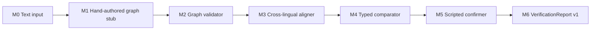

# DARI graph pipeline demo

이 디렉터리는 세 개의 짧은 합성 사례와 한 개의 합성 문단을 사용해 `text → graph → alignment → typed diff → report` 흐름을 모델 없이 재현한다.

이 데모에서 `M1 Graph Extractor`는 사람이 작성한 graph fixture를 반환하는 stub이다. 따라서 graph 이후의 계약과 비교 규칙을 확인할 수 있지만, 처음 보는 글을 자동으로 graph로 바꾸는 성능은 보여 주지 않는다.



## 실행

저장소 루트에서 실행한다.

```powershell
python experiments/verification/demos/graph_pipeline/run_demo.py
```

전체 module input/output JSON을 보려면 다음처럼 실행한다.

```powershell
python experiments/verification/demos/graph_pipeline/run_demo.py --full
```

검증된 trace와 report를 파일로 생성할 수도 있다.

```powershell
python experiments/verification/demos/graph_pipeline/run_demo.py `
  --output-dir experiments/verification/demos/graph_pipeline/outputs
```

## 모듈별 input과 output

| 모듈 | Input | Output | 이 데모의 구현 |
| --- | --- | --- | --- |
| M0 Input Contract | source/translation text, language, case ID | `VerificationCase` | 실제 v1 contract validator |
| M1 Graph Extractor | 한쪽 문서만 | `DocumentGraph`의 nodes, edges, qualifiers, evidence | 사람이 작성한 fixture lookup stub |
| M2 Graph Validator | graph와 원문 | valid/error, coverage, element count | 실제 deterministic validator |
| M3 Aligner | source/translation graph | entity/value/event alignment, 1:1 또는 1:N, unaligned IDs | `match_key`를 사용하는 oracle aligner |
| M4 Typed Comparator | 두 graph와 alignment | typed candidate diff와 근거 span | 역할·polarity·certainty·evidentiality 규칙 |
| M5 Confirmer | 위험 candidate와 원문 근거 | confirmed/rejected/abstained | hand-authored 정답을 사용하는 scripted confirmer |
| M6 Report Adapter | confirmed candidate | strict `VerificationReport v1` | 실제 pipeline과 evidence validator |

M1의 source graph는 translation text를 입력받지 않고, translation graph도 source text를 입력받지 않는다. Trace에 각 호출의 입력을 별도로 남겨 이 격리를 확인할 수 있다.

## 네 사례의 실행 결과

### 1. ACTOR/TARGET 교환

```text
Source      경찰이 민수를 체포했다.
Translation Minsu arrested the police officer.
```

```text
Source graph      ARREST --ACTOR--> police
                  ARREST --TARGET--> Minsu

Translation graph ARREST --ACTOR--> Minsu
                  ARREST --TARGET--> police
```

Event alignment에서는 `ACTOR`, `TARGET`을 제외하므로 두 체포 사건은 계속 정렬된다. Comparator는 `actor_role_change`를 만들고 최종 report는 `issues_found`가 된다.

### 2. Attribution과 certainty의 복합 변화

```text
Source      이웃 수진은 경찰이 다음 주에 우리 집을 수색할 수도 있다고 내게 말했다.
Translation The police will search our home next week.
```

```text
Source graph      COMMUNICATION --REPORTS--> SEARCH
                  reporter=Sujin, certainty=possible, evidentiality=reported

Translation graph SEARCH
                  certainty=certain, evidentiality=unspecified
```

Comparator 단계에는 `source_attribution_change`와 `certainty_shift` 두 candidate가 남는다. 같은 `SEARCH` 의미 단위의 차이이므로 report adapter는 하나의 finding으로 묶는다.

```json
{
  "type": "source_attribution_change",
  "related_types": ["certainty_shift"],
  "severity": "high",
  "status": "confirmed"
}
```

내용 사건은 target에 남아 있으므로 source의 `COMMUNICATION` event를 일반 `omission`으로 중복 보고하지 않는다.

### 3. 정상적인 1:2 의역

```text
Source      경찰은 나를 다음 날 아침 석방했다.
Translation The next morning, the police stopped holding me and allowed me to leave.
```

```text
Source event       RELEASE
                         ↘ 1:2 alignment
Translation events STOP_HOLDING + ALLOW_LEAVE
```

두 target event를 합쳤을 때 행위자, 대상, 시간, polarity, certainty, evidentiality가 source의 `RELEASE`와 같다. Comparator 결과는 빈 배열이고 최종 report는 `completed`다. 이 사례는 표현이 길어졌다는 이유만으로 오류를 만들지 않는 정상 대조군이다.

### 4. 문단 안의 국소적인 certainty 변화

```text
Source      5월 3일 민수는 광장 시위에 참여했다. 시위가 끝난 뒤 경찰관 두 명이
            그의 집을 수색했다. 이웃 수진은 경찰이 다시 올 수도 있다고 민수에게
            말했다. 다음 날 민수는 다른 도시로 이동했다.

Translation On May 3, Minsu joined a protest in the square. After it ended, two police
            officers searched his home. Sujin told Minsu that the police would definitely
            return. The next day, Minsu moved to another city.
```

```text
PROTEST ↔ PROTEST     preserved
SEARCH  ↔ SEARCH      preserved
REPORT  ↔ REPORT      reporter=Sujin preserved
RETURN  ↔ RETURN      certainty: possible → certain
MOVE    ↔ MOVE        preserved
```

다섯 사건과 인물·장소·시간을 먼저 1:1로 정렬한다. 수진이 전달한 정보라는 reporting frame은 양쪽에 그대로 있으므로 `source_attribution_change`는 만들지 않고, `RETURN` 사건의 `certainty_shift` 하나만 최종 finding으로 보고한다. 문장 간 인물 참조와 사건 연결도 이 hand-authored graph에 포함되지만 자동 coreference 성능을 측정한 결과는 아니다.

## 모델이 필요한 단계

| 단계 | 모델 필요 여부 |
| --- | --- |
| 사람이 작성한 graph로 module 계약 시연 | 불필요 |
| Graph schema와 evidence 검사 | 불필요 |
| Gold graph alignment와 typed diff 시험 | 불필요 |
| Report 생성 | 불필요 |
| 처음 보는 자유 문장을 자동 graph로 변환 | 필요. multilingual LLM 또는 SRL/parser 후보 |
| 실제 문장의 어려운 entity/event alignment | 선택적. multilingual embedding이 유용 |
| 애매한 candidate 재확인 | 선택적. 별도 모델 또는 사람 검토 |

따라서 첫 실험은 모델 없이 comparator의 Oracle 성능을 확인한다. 그 규칙이 맞는 것을 확인한 다음 M1 stub을 실제 extractor adapter로 교체하고 `predicted graph`와 `gold graph` 차이를 측정한다.

## 파일

- [demo_cases.json](demo_cases.json): 세 개의 짧은 사례와 한 개의 문단 사례에 대한 hand-authored source/translation graph
- [run_demo.py](run_demo.py): 모델 없는 실행 진입점
- `outputs/*.trace.json`: 모든 모듈의 input/output을 담는 연구용 GraphTrace
- `outputs/*.report.json`: strict v1 최종 report
